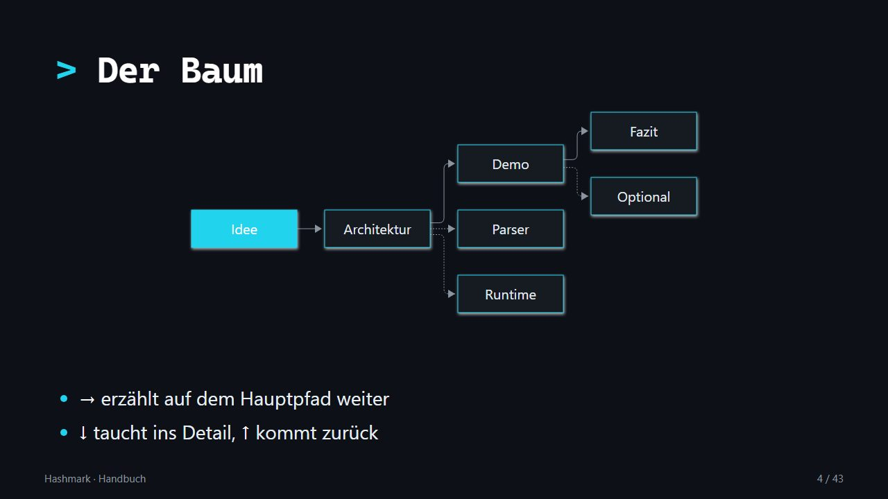
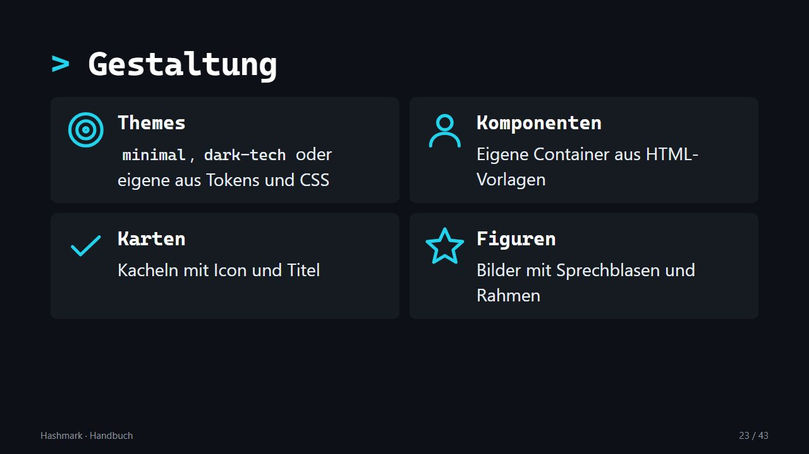
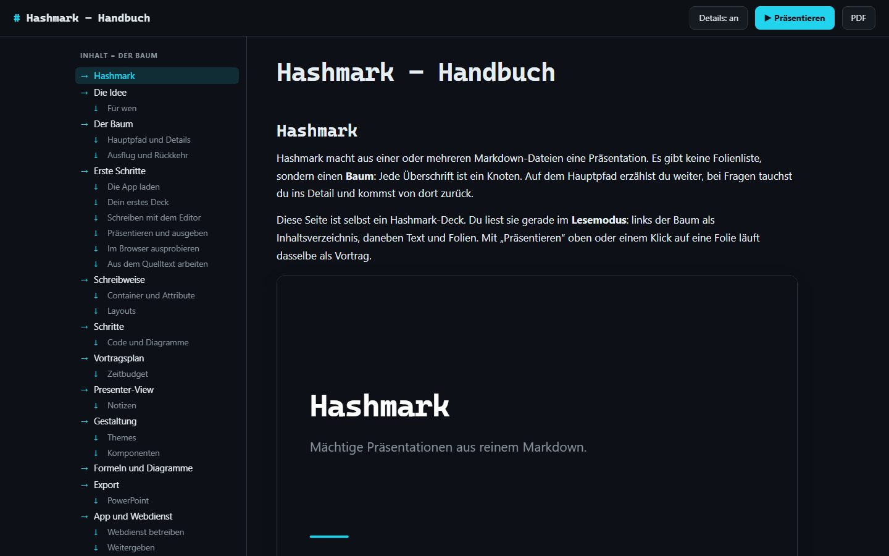

# Hashmark

**Mächtige Präsentationen aus reinem Markdown.**

[](https://github.com/goerks/Hashmark/actions/workflows/ci.yml)
[](https://github.com/goerks/Hashmark/releases/latest)

[**Webseite**](https://goerks.github.io/Hashmark/) · [**Funktionen**](https://goerks.github.io/Hashmark/funktionen/) · [**Handbuch**](https://goerks.github.io/Hashmark/handbuch/?reader) · [**Live ausprobieren**](https://hashmark.onrender.com) · [**Download**](https://github.com/goerks/Hashmark/releases/latest)


Hashmark macht aus einer oder mehreren Markdown-Dateien eine Präsentation, aber nicht als Folienstapel, sondern als **Baum**: Jede Überschrift ist ein Knoten. **→** erzählt auf dem Hauptpfad weiter, **↓** taucht ins Detail ab, **↑** kommt zurück. Fragen aus dem Publikum und knappe Zeit sind damit kein Problem mehr, und es gibt keine Backup-Folien am Ende, die man unter Druck sucht.

## Was Hashmark kann

| | |
| --- | --- |
| [**Baum und Navigation**](https://goerks.github.io/Hashmark/funktionen/navigation/) | Jede Überschrift ist ein Knoten. **→** erzählt den Hauptpfad, **↓** taucht ins Detail, Space führt nach einem Abstecher zurück. Übersicht, Suche und Links auf jede Folie. |
| [**Schritte und Animationen**](https://goerks.github.io/Hashmark/funktionen/schritte/) | Listen, Code Zeile für Zeile, wachsende Diagramme, Formelteile und die Ebenen von draw.io- und Excalidraw-Zeichnungen erscheinen nacheinander. Übergänge folgen dem Baum, Z fährt die Kamera auf ein Bild. |
| [**Layouts und Gestaltung**](https://goerks.github.io/Hashmark/funktionen/gestaltung/) | 17 Layouts mit einem Wort an der Überschrift, dazu Karten, Figuren mit Sprechblasen, Tabellen, Bildband, Hinweiskästen und fertige Bausteine wie Pipeline, Statusautomat, Zeitplan und Checkliste, alles als Markdown. |
| [**Themes und Firmen-Look**](https://goerks.github.io/Hashmark/funktionen/themes/) | `minimal` und `dark-tech` eingebaut, eigener Look über Tokens, eigene Layouts und Komponenten aus HTML-Vorlagen mit fertigen Funktionen zum Rechnen und Formatieren (ohne JavaScript). |
| [**Diagramme, Formeln, Medien**](https://goerks.github.io/Hashmark/funktionen/medien/) | Mermaid in den Farben des Themes, KaTeX, Code-Hervorhebung, Video und QR-Codes. Nichts wird von außen geladen. |
| [**Vortrag und Presenter**](https://goerks.github.io/Hashmark/funktionen/vortrag/) | Notizen, Timer, Zeitplan und Baum auf dem zweiten Bildschirm. Ein Vortragsplan mit Pfad, Optional und Anhang, ein Zeitbudget kürzt von selbst. |
| [**Editor und App**](https://goerks.github.io/Hashmark/funktionen/editor/) | Editor mit Live-Vorschau und Vorschlägen, „Prüfen“ findet Fehler und volle Folien. Desktop-App ohne Installer, Webdienst als Docker-Image. |
| [**Export und Weitergabe**](https://goerks.github.io/Hashmark/funktionen/export/) | PDF, Handout mit Notizen, **bearbeitbares PowerPoint mit Animationen** und eine einzelne HTML-Datei, die offline läuft. |

| | |
| --- | --- |
|  |  |
| Diagramme in den Farben des Themes | Karten, Spalten, Figuren und Komponenten, die selbst rechnen |



Das Handbuch ist selbst ein Hashmark-Deck, hier im Lesemodus.

## In 60 Sekunden

````markdown
# Architektur {layout=title}

## Parser

- Markdown rein, Baum raus {steps}

## Runtime {optional}

Nur bei Fragen: ↓ taucht ab, Space führt zurück.
````

Alle Schreibweisen, Tasten und Befehle stehen im Teil „Nachschlagen“ des [Handbuchs](https://goerks.github.io/Hashmark/handbuch/?reader).

## Mit KI Präsentationen schreiben

Eine KI kann ein Deck ohne Vorwissen bauen: [`hashmark-fuer-ki.md`](hashmark-fuer-ki.md) beschreibt Deck-Ordner, `deck.yaml`, Baum, Attribute, Layouts, Container, Schritte und Medien samt Checkliste und Beispiel. Die Datei der KI mitgeben (oder ihre [Rohfassung](https://raw.githubusercontent.com/goerks/Hashmark/main/hashmark-fuer-ki.md) verlinken), dann das Thema nennen. Mit `hashmark check` prüfst du das Ergebnis.

## Loslegen

1. **App laden:** Paket für deine Plattform aus den [Releases](https://github.com/goerks/Hashmark/releases/latest) entpacken, `Hashmark.exe` starten. Kein Installer nötig.
2. **Neues Deck** anlegen (Strg+N) oder ein Beispiel öffnen, schreiben, mit **F5** präsentieren.
3. **Ausprobieren ohne Download:** [hashmark.onrender.com](https://hashmark.onrender.com) zeigt den Webdienst mit Beispiel-Deck (Präsentation und Editor ohne Anmeldung).

Die ausführliche Anleitung steht im Teil „Lernen“ des [Handbuchs](https://goerks.github.io/Hashmark/handbuch/?reader).

## Mehr

| | |
| --- | --- |
| [Handbuch](https://goerks.github.io/Hashmark/handbuch/?reader) | Lernen, Themen, Nachschlagen (alle Schreibweisen, Tasten, Befehle), häufige Fragen |
| [Funktionen](https://goerks.github.io/Hashmark/funktionen/) | die acht Bereiche mit Bildern und Beispielen |
| [Beispiel-Decks](https://goerks.github.io/Hashmark/beispiele/) | Funktionen, eigenes Theme, Komponenten, Formeln |
| [Hashmark für KI](hashmark-fuer-ki.md) | vollständige Beschreibung des Deck-Aufbaus, damit eine KI ohne weitere Hinweise gültige Präsentationen schreibt |
| [Live-Instanz](https://hashmark.onrender.com) | Webdienst auf Render |
| [Roadmap](roadmap.md) · [Konzept](konzept-markdown-praesentations-app.md) | wohin es geht und warum |
| [CONTRIBUTING.md](CONTRIBUTING.md) | selbst bauen, Befehle, Workflow für Pull Requests |

## Lizenz

[PolyForm Noncommercial 1.0.0](LICENSE): frei nutzen, ändern und weitergeben, nicht für kommerzielle Zwecke. Kommerzielle Nutzung bitte vorher anfragen.
