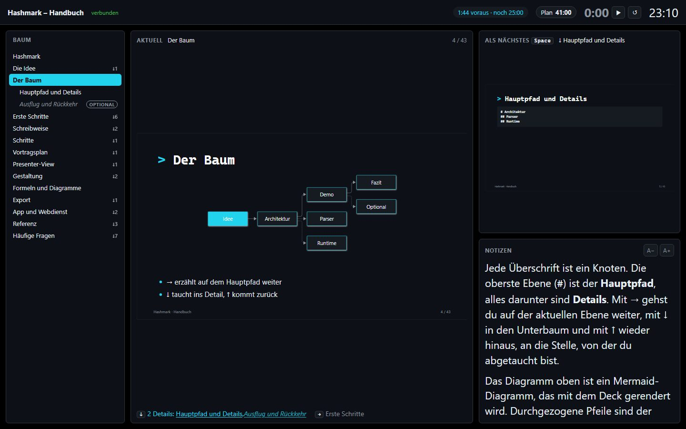

# Hashmark

**Mächtige Präsentationen aus reinem Markdown.**

[](https://github.com/goerks/Hashmark/actions/workflows/ci.yml)
[](https://github.com/goerks/Hashmark/releases/latest)

[**Dokumentation**](https://goerks.github.io/Hashmark/) · [**Handbuch**](https://goerks.github.io/Hashmark/handbuch/?reader) · [**Live ausprobieren**](https://hashmark.onrender.com) · [**Download**](https://github.com/goerks/Hashmark/releases/latest)



Hashmark macht aus einer oder mehreren Markdown-Dateien eine Präsentation, aber nicht als Folienstapel, sondern als **Baum**: Jede Überschrift ist ein Knoten. **→** erzählt auf dem Hauptpfad weiter, **↓** taucht ins Detail ab, **↑** kommt zurück. Fragen aus dem Publikum und knappe Zeit sind damit kein Problem mehr, und es gibt keine Backup-Folien am Ende, die man unter Druck sucht.

## Warum Hashmark?

- **Baum statt Liste:** Details liegen unter ihrem Kapitel und tauchen nur bei Bedarf auf.
- **Vortragsplan:** Jeder Knoten ist Pfad, Optional oder Anhang. Ein Zeitbudget wirft das Unwichtigste aus dem Pfad, die Leertaste führt nach einem Abstecher von selbst zurück.
- **Presenter-View:** Notizen, Timer, Zeitplan und der Baum auf dem zweiten Bildschirm.
- **Nur Text:** Eine Quelle, die Diff, Review und Git versteht. Formeln (KaTeX), Diagramme (Mermaid), Code mit Zeilen-Schritten und QR-Codes sind eingebaut.
- **Ausgeben, wie du willst:** PDF, Handout mit Notizen, **bearbeitbares PowerPoint mit Animationen** und eine einzelne HTML-Datei, die offline läuft.
- **Offline und ohne Installer:** Standalone-App für Windows, Linux und macOS. Keine CDNs, kein Konto, deine Dateien bleiben bei dir.

## In 60 Sekunden

````markdown
# Architektur {layout=title}

## Parser

- Markdown rein, Baum raus {steps}

## Runtime {optional}

Nur bei Fragen: ↓ taucht ab, Space führt zurück.
````

Mehr zum Schreiben, zu Layouts, Themes und Komponenten steht im [Handbuch](https://goerks.github.io/Hashmark/handbuch/?reader), das selbst ein Hashmark-Deck ist.

## Loslegen

1. **App laden:** Paket für deine Plattform aus den [Releases](https://github.com/goerks/Hashmark/releases/latest) entpacken, `Hashmark.exe` starten. Kein Installer nötig.
2. **Neues Deck** anlegen (Strg+N) oder ein Beispiel öffnen, schreiben, mit **F5** präsentieren.
3. **Ausprobieren ohne Download:** [hashmark.onrender.com](https://hashmark.onrender.com) zeigt den Webdienst mit Beispiel-Deck (Präsentation öffentlich, Editor mit Passwort).

Die ausführliche Anleitung steht im Kapitel „Erste Schritte“ des [Handbuchs](https://goerks.github.io/Hashmark/handbuch/?reader).

## Mehr

| | |
| --- | --- |
| [Handbuch](https://goerks.github.io/Hashmark/handbuch/?reader) | Schreiben, Gestalten, Vortragsplan, Export, App und Webdienst, FAQ |
| [Beispiel-Decks](https://goerks.github.io/Hashmark/beispiele/) | Funktionen, eigenes Theme, Komponenten, Formeln |
| [Live-Instanz](https://hashmark.onrender.com) | Webdienst auf Render |
| [Roadmap](roadmap.md) · [Konzept](konzept-markdown-praesentations-app.md) | wohin es geht und warum |
| [CONTRIBUTING.md](CONTRIBUTING.md) | selbst bauen, Befehle, Workflow für Pull Requests |

## Lizenz

[PolyForm Noncommercial 1.0.0](LICENSE): frei nutzen, ändern und weitergeben, nicht für kommerzielle Zwecke. Kommerzielle Nutzung bitte vorher anfragen.
