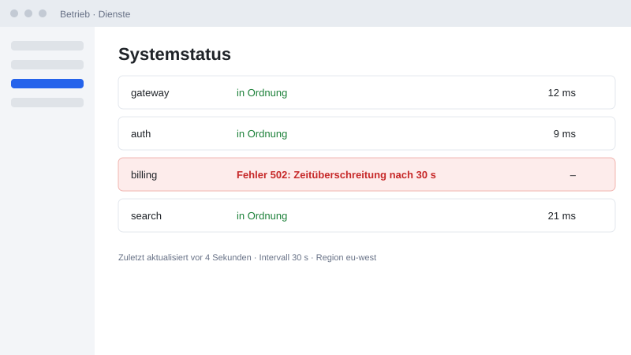
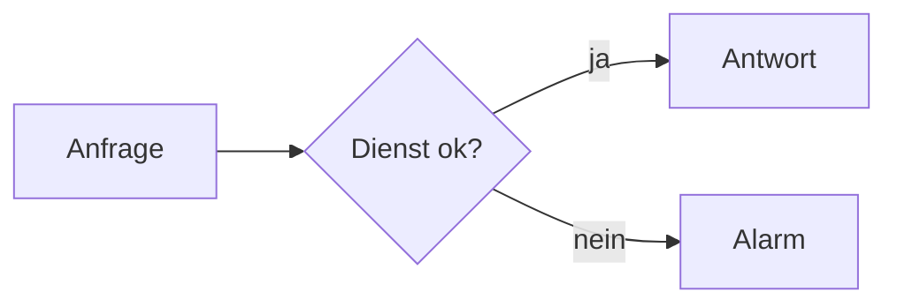

# Abnahme: Bild-Zoom {layout=title}

Ticket #6 · diese Präsentation zeigt die Neuerung selbst

::: notes
Das ist die Abnahme-Präsentation für Ticket #6 (Bild-Zoom). Alle Folien sind die echte Funktion, nichts ist nachgebaut. Am Ende steht, was ich nicht prüfen konnte.
:::

# So läuft die Abnahme {steps}

- **→** geht weiter, **←** zurück, **F5** Vollbild
- **Z** fährt die Kamera auf ein Bild, **Z**, **Esc** oder ein Klick fährt zurück
- Ein **Klick auf das Bild** wirkt wie Z; **+** und **−** fahren tiefer bzw. heraus
- Ein Bild kann auch **von selbst** hineinfahren, allein durch →
- **S** öffnet die Presenter-View: Dort funktioniert Z ebenfalls
- Am Ende: was **nicht** geprüft werden konnte

::: notes
Keine Installation nötig: Die Präsentation läuft im Browser. Für die Presenter-View brauchst du ein zweites Fenster (Taste S).
:::

# Status der Dienste {id=zoom-bild layout=image-right}



- Die Fehlermeldung ist im Bild klein
- **Z** drücken: Die Kamera fährt hinein
- Noch einmal **Z**: zurück

::: notes
**Prüfen:** Drücke Z. Die Kamera fährt in die Folie hinein, das Bild füllt die Bühne, Titel und Text wandern mit aus dem Bild. Z, Esc oder ein Klick fährt zurück. Während die Kamera fährt, bleiben die Bedienelemente stehen. Mit → gehst du weiter, der Zoom ist dann zurückgesetzt.
:::

# Bild mit Schritten {id=zoom-schritte}

::: steps
- Erster Schritt: nur der Text
- Zweiter Schritt: das Bild erscheint
:::

{step=2 width=55%}

::: notes
**Prüfen:** Im ersten Schritt gibt es nichts zu vergrößern, Z tut nichts. Nach dem zweiten Schritt (→) ist das Bild da, und Z fährt hinein.
:::

# Zoom beim Durchsteppen {id=zoom-schritt}

::: steps
- Erster Schritt: nur der Text, das Bild ist klein
- Zweiter Schritt: die Kamera fährt von selbst aufs Bild
- Dritter Schritt: die Kamera fährt wieder heraus
:::

{zoomstep=2 zoomuntil=3 width=40%}

::: notes
**Prüfen:** Nur → drücken, nie Z. Schritt 1 zeigt den Text. Schritt 2 (→): die Kamera fährt von selbst aufs Bild. Schritt 3 (→): sie fährt wieder heraus. ← kehrt jeden Schritt um. Im Presenter zählt der Zoom als Schritt in der Schrittanzeige, und → im Presenter löst ihn ebenfalls aus. Ohne `zoomuntil` bliebe die Kamera, bis die Folie wechselt.
:::

# Tiefer hinein {id=zoom-tief}

{width=40%}

- **Z**, dann **+**: eine Stufe tiefer
- **Pfeile** verschieben den Ausschnitt, die **Minikarte** zeigt, wo man ist
- **−** fährt zurück, **Esc** ganz heraus

::: notes
**Prüfen:** Z drücken, dann mehrmals +. Unten rechts erscheint die Minikarte, die Pfeile verschieben den Ausschnitt (→ blättert hier nicht, Space schon). Mit − wieder heraus. Mausrad: sobald die Kamera fährt, zoomt es am Zeiger. Strg + Mausrad (Touchpad-Spreizen) startet den Zoom auch aus der Normalansicht.
:::

# Code und Diagramm {id=zoom-code}

```ts
function pruefe(dienst: Dienst) {
  if (dienst.status !== 'ok') {
    alarm(dienst.name, dienst.fehler)
  }
}
```



| Dienst | Status |
| --- | --- |
| Web | ok |
| Datenbank | Fehler 502 |

::: notes
**Prüfen:** Hier gibt es kein `{zoom}`: Code, Diagramm und Tabelle lassen sich immer vergrößern. Z fährt auf das erste Ziel, ein Klick auf eines der drei Ziele auf dieses.
:::

# Dieses Bild nicht {id=zoom-aus}

{zoom=off width=55%}

::: notes
**Prüfen:** In dieser Präsentation gilt `zoom: true` in der `deck.yaml` für alle Bilder. Dieses Bild ist mit `{zoom=off}` ausgenommen: Z und Klick tun hier nichts.
:::

# Presenter-View {id=presenter}

- **S** öffnet das zweite Fenster
- Dort steht **„Bild: normal · Z vergrößern“**
- **Z** im Presenter fährt im Präsentationsfenster hinein

::: notes
**Prüfen:** Gehe zur Folie „Status der Dienste“, öffne die Presenter-View mit S und drücke dort Z. Das Präsentationsfenster fährt aufs Bild, der Presenter zeigt „Bild: vergrößert · Z zurück“.
:::

# Schreibweise {id=schreibweise}

```md
{zoom}
{zoom=off}
{zoomstep=2 zoomuntil=3}
```

```yaml
# deck.yaml: alle Bilder vergrößerbar
zoom: true
```

::: notes
`{zoom}` macht ein Bild vergrößerbar, `zoom: true` in der `deck.yaml` alle Bilder, `{zoom=off}` nimmt eines aus. `zoomstep=N` fährt bei Schritt N von selbst hinein, `zoomuntil=M` bei Schritt M wieder heraus. Das Handbuch beschreibt alles unter „Gestaltung › Bild vergrößern“.
:::

# Nicht geprüft {id=offen}

::: cards cols=2
::: card icon=target title="Echte Geräte"
Touchpad-Spreizen und Mausrad habe ich nur mit künstlichen Ereignissen geprüft, nicht mit echten Geräten. Wie sich die Minikarte und der tiefe Zoom beim Vortragen anfühlen, kann ich nicht beurteilen.
:::
::: card icon=user title="Desktop-App"
Presenter-Fenster der App und Vollbild auf dem Beamer.
:::
::: card icon=check title="Export"
PDF und PowerPoint zeigen das Bild unverändert, der Zoom ist nur in der Präsentation.
:::
::: card icon=star title="Weitere Geräte"
Touch-Bedienung, Linux und macOS.
:::
:::

::: notes
Die Pipeline hat Z, Klick, Esc, Zurücksetzen beim Blättern und die Presenter-Kopplung in einem echten Chrome geprüft. Das sind die Punkte, die ich nicht prüfen konnte.
:::
