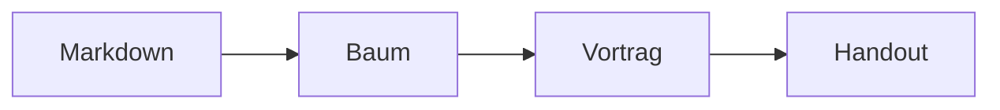
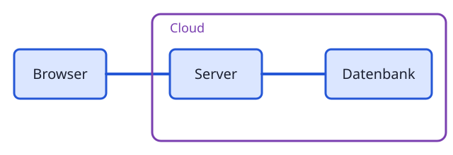

# Auftritt der Bausteine {layout=title}

Abnahme zu Ticket #29: Wie erscheinen Bausteine, Diagramme und Zeichnungen Schritt für Schritt?

::: notes
Prüfen: Auf jeder der folgenden Folien mit → Schritt für Schritt vorgehen und auf den Auftritt achten. Ohne `effect=` hat jeder Baustein einen eigenen Auftritt, der zu seiner Form passt. Mit `effect=fade` ist es wie bisher.
:::

# Prozess: von links aufgedeckt {id=prozess}

::: process steps
- **Planen** Ziele klären
- **Bauen** Umsetzen
- **Prüfen** Testen
- **Liefern** Ausrollen
:::

::: notes
Prüfen: Mit → wird jede Phase von links nach rechts aufgedeckt, wie ein Wischen. Einstellung: keine, das ist der Standard von `process`.
:::

# Pipeline und Zeitplan {id=pipeline}

::: pipeline title="Release 4.2" steps
::: stage label="Bauen" state=done time="1:12 min"
:::
::: stage label="Testen" state=run progress=62
:::
::: stage label="Prüfen"
:::
::: stage label="Ausrollen"
:::
:::

::: notes
Prüfen: Die Stufen werden nacheinander von links aufgedeckt. Bei `gantt` und `roadmap` ist es genauso.
:::

# Zeitplan {id=zeitplan}

::: gantt title="Projektplan 2027" scale=12 now=6 from="Jan" to="Dez" steps
::: task label="Konzept" start=0 length=2 state=done
:::
::: task label="Bau" start=2 length=5
:::
::: task label="Test" start=6 length=3
:::
::: task label="Rollout" start=9 length=3
:::
:::

::: notes
Prüfen: Jede Zeile wird von links aufgedeckt, der Balken erscheint mit.
:::

# Timeline {id=timeline}

::: timeline title="Roadmap" steps
- **Q1** Erster Meilenstein
- **Q2** Zweiter Meilenstein
- **Q3** Dritter Meilenstein
:::

::: notes
Prüfen: Die Einträge gleiten von links an ihren Platz.
:::

# Kennzahlen mit Zählern {id=kennzahlen}

::: kpis countup steps
::: kpi value="94 %" label="Zufriedenheit" trend=up delta="+4 %"
:::
::: kpi value="3,2 s" label="Antwortzeit" trend=down
:::
::: kpi value="1.200" label="Kunden"
:::
:::

::: notes
Prüfen: Mit → wachsen die Kacheln als kleine Welle auf, und die Zahlen laufen von 0 auf ihren Wert hoch (94 %, 3,2 s, 1.200). Einstellung: `::: kpis countup steps`. Ohne `countup` stehen die Zahlen sofort da.
:::

# Checkliste {id=checkliste}

::: checklist title="Go-Live-Vorbereitung" steps
::: item label="Daten migrieren" state=done owner=Anna
:::
::: item label="Schulung planen" state=wip owner=Ben
:::
::: item label="Freigabe holen"
:::
:::

::: notes
Prüfen: Die Zeilen schweben nacheinander von unten ein.
:::

# Pyramide {id=pyramide}

::: pyramid steps
- Infrastruktur
- Plattform
- Dienste
- Oberfläche
:::

::: notes
Prüfen: Die Ebenen bauen sich nacheinander auf, aus der Mitte aufgehend.
:::

# Mermaid wächst {id=mermaid}

::: notes
Prüfen: Mit → wächst das Diagramm. Die schon sichtbaren Knoten bleiben genau an ihrem Platz und verschieben sich nicht. Der neue Knoten blendet ein und wächst leicht auf, die neue Kante zeichnet sich von Anfang bis Ziel. Mit ← geht es genauso zurück.
:::

# Zeichnung {id=zeichnung}

{steps=ids}

::: notes
Prüfen: Mit → zeichnet sich Schritt für Schritt die Architektur: Browser, Verbindung und Server, Verbindung und Datenbank, zuletzt der Cloud-Rahmen. Die Linien zeichnen sich, die Flächen füllen sich danach.
:::

# Zum Vergleich: wie bisher {steps effect=fade id=wie-bisher}

::: process
- **Planen** Ziele klären
- **Bauen** Umsetzen
- **Prüfen** Testen
:::

::: notes
Prüfen: Mit `effect=fade` an der Folie wird der Standard abgeschaltet: Die Phasen blenden nur ein. Einstellung: `## Titel {steps effect=fade}`.
:::

# Nicht geprüft {id=nicht-geprueft}

- Wirkung im PowerPoint-Export und im PDF: bleibt Einblenden bzw. Endzustand
- Mermaid-Diagramme außer Flussdiagrammen (Sequenz-, Zustands-, Klassendiagramme): dort kann sich die Anordnung bei neuen Versionen weiterhin ändern
- Eigene Komponenten aus Themes: bekommen keinen Standard-Auftritt
- Touch-Gesten am Tablet

::: notes
Hier steht, was Claude nicht selbst im Browser ausprobieren konnte.
:::
