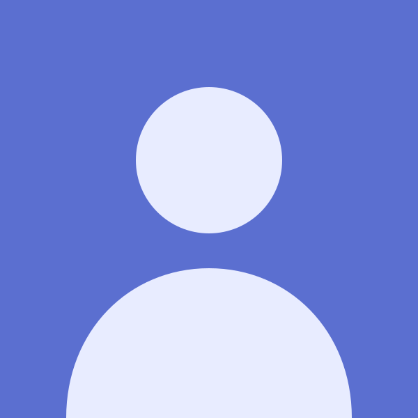
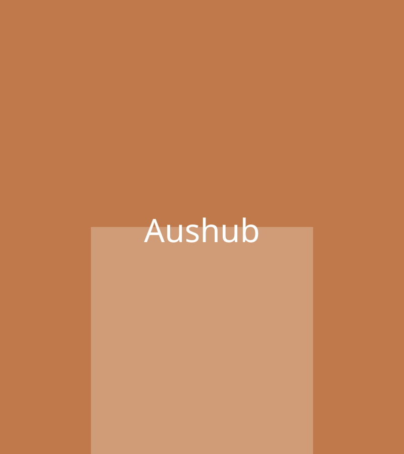
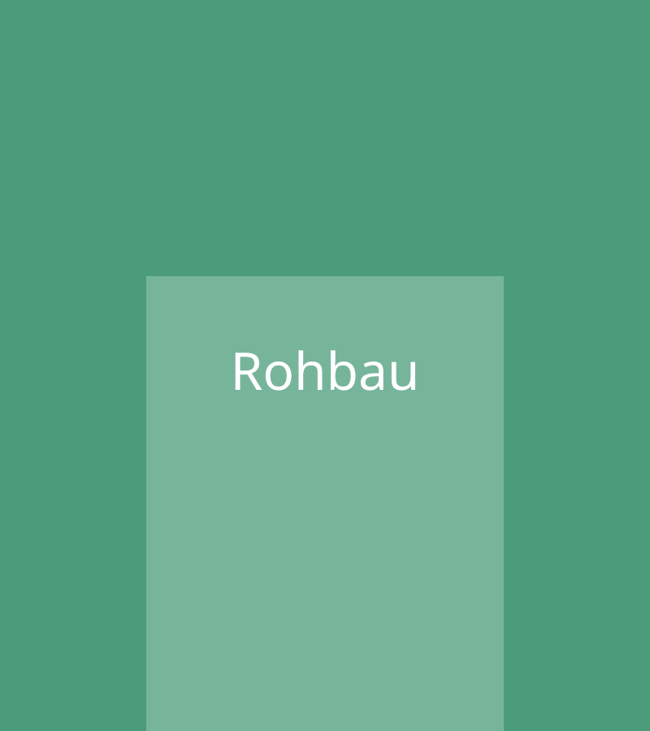
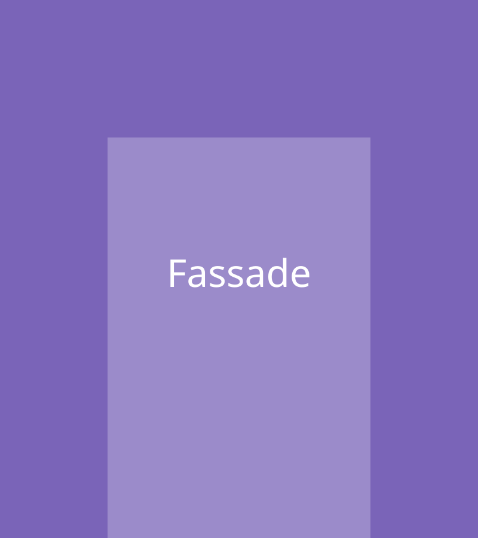
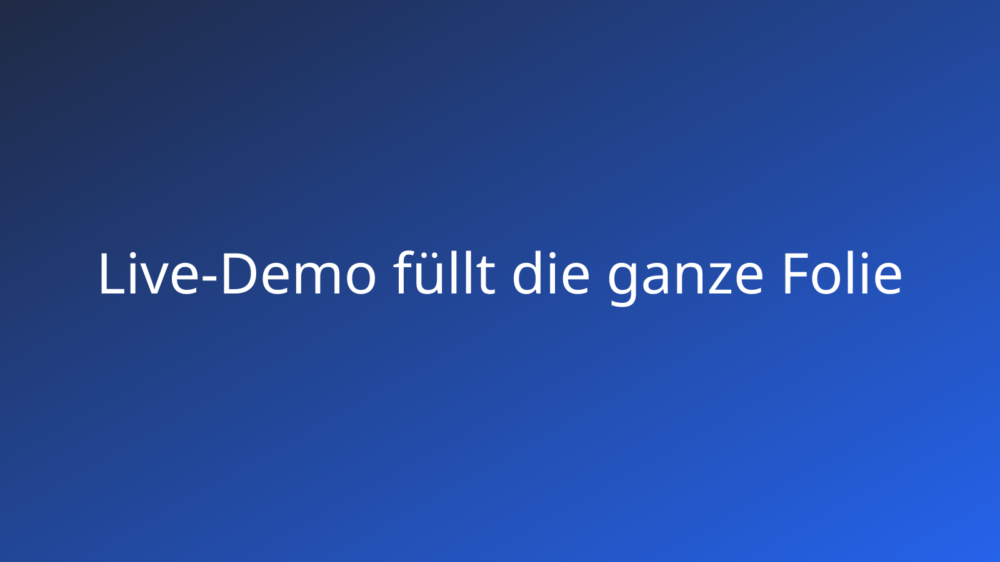

# Sechs neue Layouts {layout=title}

Abnahme Ticket #27 · Kontakt, Kennzahlen, Große Zahl, Galerie, Zeitstrahl, Leer

::: notes
Prüfen: Mit → durch alle Folien gehen. Jede Folie zeigt ein neues Layout mit der echten Funktion. Zum Nachlesen: Adresse mit `/?reader` am Ende öffnen.

Die Reihenfolge: Kontakt, Kennzahlen, Große Zahl, Galerie, Zeitstrahl, Leer, dann die Schreibweise und „Nicht geprüft“.
:::

# Kontakt {layout=contact}



**Michael Burkard**
Leiter Digitalisierung

- E-Mail: michael.burkard@bbv.ch
- Telefon: +41 00 000 00 00
- Web: hashmark.example
- Adresse: Musterstrasse 1, 6000 Luzern

::: notes
Prüfen: Links Foto (rund), darunter Name groß und Funktion in der Akzentfarbe. Rechts die vier Details, jeweils mit kleiner Beschriftung. Passt das so für eine Schlussfolie? Ist die runde Form gewünscht oder lieber ein hohes Rechteck?
:::

# Zahlen 2026 {layout=kpi}

- **42 %** weniger Rückfragen
- **3,2 s** Ladezeit
- **18** neue Kunden
- **4,6** Zufriedenheit

::: notes
Prüfen: Vier Kacheln mit großer Zahl und Beschriftung, aus einer einfachen Liste. Probiere im Editor, eine Zeile zu löschen oder hinzuzufügen: Die Kacheln verteilen sich neu.
:::

# Marktanteil {layout=big-number}

**38 %**

der Kunden nutzen es täglich

Quelle: interne Erhebung, Q3

::: notes
Prüfen: Eine einzige Zahl, riesig und in der Akzentfarbe, darunter die Beschriftung und klein die Quelle. Der Titel steht klein oben.
:::

# Baustelle im Überblick {layout=gallery}





::: notes
Prüfen: Drei Bilder gleich hoch nebeneinander, darunter der Alt-Text als Unterschrift. Die Bilder sind hier Platzhalter; mit Fotos werden sie zugeschnitten (nicht verzerrt).
:::

# Fahrplan {layout=timeline}

- **Q1** Konzept
- **Q2** Pilot
- **Q3** Rollout
- **Q4** Betrieb

::: notes
Prüfen: Waagerechter Zeitstrahl mit Punkten, darüber Quartal, darunter der Text. Funktioniert auch mit {steps} an der Überschrift, wenn die Punkte nacheinander erscheinen sollen.
:::

# Demo {layout=blank}



::: notes
Prüfen: Keine Überschrift, keine Fußzeile, das Bild füllt die ganze Folie. Gedacht für Videos oder eine Live-Demo. Der Titel „Demo“ bleibt trotzdem in Suche und Übersicht (Taste O bzw. Strg+K).
:::

# So schreibst du es {layout=code-focus}

```md
## Kontakt {layout=contact}


**Anna Beispiel**
Leiterin Digitalisierung

- E-Mail: anna@firma.ch
- Telefon: +41 00 000 00 00
```

::: notes
Prüfen: So einfach ist die Schreibweise der Kontaktfolie. Die anderen Layouts stehen im Handbuch unter „Nachschlagen › Layouts“. Die KI-Beschreibung (`hashmark-fuer-ki.md`) kennt sie ebenfalls.
:::

# Nicht geprüft {layout=statement}

Dunkles Theme, Druck und PowerPoint-Export

::: notes
Nicht in der Vorschau prüfbar: Das dunkle Theme (`dark-tech`) habe ich nur an Bildschirmfotos der Layouts gesehen, nicht in der laufenden App. Probiere es, indem du in der `deck.yaml` `theme: dark-tech` setzt. Ebenso nicht getestet: PDF-Druck und PowerPoint-Export dieser Folien. Auch die Programmtests konnte ich in meiner Umgebung nicht ausführen (kein Zugriff auf den Paketserver); sie laufen in der Pipeline.
:::
