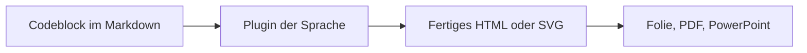
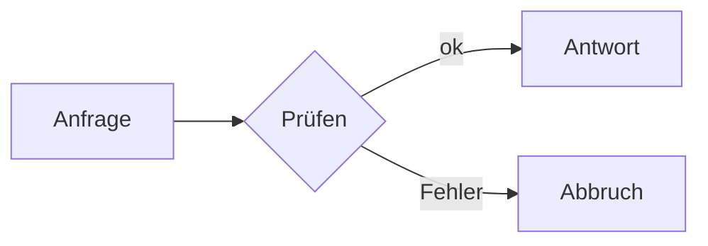

# Plugins in Hashmark {layout=title}

Abnahme zu Ticket #56: Erweiterungen melden sich über eine Schnittstelle an. Diese Präsentation führt jedes Plugin an sich selbst vor.

::: notes
Prüfen: Die Vorschau zeigt diese Abnahme-Präsentation. Mit Pfeil rechts geht es auf dem Hauptpfad weiter, mit Pfeil nach unten tauchst du in die einzelnen Plugins ab. `/?reader` zeigt alles als Text zum Nachlesen.
:::

# Was ist ein Plugin? {layout=diagram}



::: notes
Prüfen: Das Diagramm wächst mit jedem Schritt (Pfeil rechts oder Leertaste). Ein Plugin bekommt den Text eines Codeblocks und liefert fertiges HTML. Es läuft nur beim Laden des Decks, nie im Browser des Publikums.
:::

# Alle Plugins im Überblick {layout=default}

```markmap {height=400 title="Plugins"}
# Plugins
- **Diagramme**
  - Mermaid
  - Markmap
- **Zeichen**
  - QR-Code
  - Formeln
- **Code**
  - Hervorhebung
  - Zeilen als Schritte
```

::: notes
Prüfen: Diese Mindmap ist selbst das Markmap-Plugin. Sie zeigt alle mitgelieferten Plugins mit ihren Farben je Ast.
:::

# Die Plugins {layout=section}

Jedes Plugin zeigt sich selbst. Pfeil nach unten führt hinein.

::: notes
Prüfen: Die Kacheln zeigen die fünf Plugins. Ein Klick oder Pfeil nach unten öffnet sie.
:::

## Markmap {layout=default}

```markmap {height=380}
# Hashmark
- **Kern**
  - Parser
  - Plan
  - Plugins
- Runtime
  - Presenter
  - Editor
- Export
  - PDF
  - PPTX
```

::: notes
Prüfen: Zehn Knoten (die Mitte und neun Punkte), jeder Ast in einer anderen Farbe, nichts ragt über den Rand. Der Quelltext darüber ist eine einfache Gliederung. Neu mit diesem Ticket. Attribute: `height`, `fold`, `title`.
:::

## Mermaid {layout=default}



::: notes
Prüfen: Das Diagramm trägt die Farben des Themes. Mermaid läuft jetzt über dieselbe Plugin-Schnittstelle wie Markmap, für Anwender sieht es aus wie vorher.
:::

## QR-Code {layout=default}

```qr {size=220 label="Dieser Pull Request"}
https://github.com/goerks/Hashmark/pull/84
```

::: notes
Prüfen: Der QR-Code führt zur Adresse im Block (mit dem Handy scannen, falls zur Hand). Er ist ein Bild ohne externen Dienst. Attribute: `size`, `label`.
:::

## Formeln {layout=default}

```math {step=0}
\int_0^1 x^2\,dx = \tfrac{1}{3}
```

```math {step=1}
E = mc^2
```

::: notes
Prüfen: Die erste Formel steht sofort, die zweite erscheint mit dem ersten Schritt (`step=1`). Gesetzt mit KaTeX, ohne Netz.
:::

## Code {layout=default}

```ts {title="plugins.ts" lines="1|2-4"}
registerPlugin({ name: 'markmap', api: PLUGIN_API, codeBlocks: [markmapPlugin] }, { builtin: true })
// ungültig → Fehler mit verständlichem Satz
registerPlugin({ name: 'Falsch', api: 99 })
// → „Das Plugin ist für Version 99 gebaut, Hashmark kennt Version 1.“
```

::: notes
Prüfen: Die erste Zeile ist hervorgehoben, mit dem Schritt die Zeilen 2 bis 4. So meldet sich ein Plugin an und so lehnt Hashmark ein ungültiges ab.
:::

# Nicht geprüft {layout=default}

- Markmap in PowerPoint (nur automatisch getestet, nicht in PowerPoint geöffnet)
- Plugins aus dem Deck-Ordner und die Vertrauensabfrage (folgt in Stufe 2)
- Linux und macOS

::: notes
Hier stehen die Punkte, die ich nicht selbst prüfen konnte.
:::
