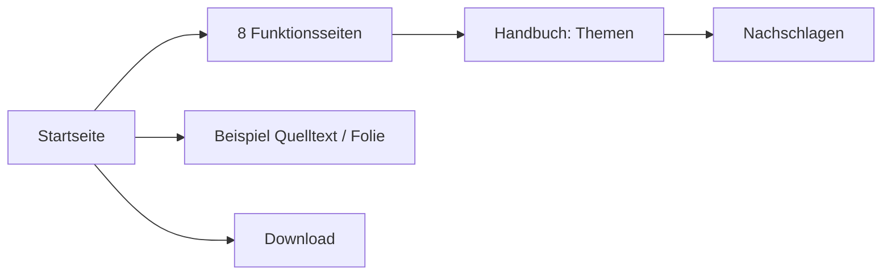

# Webauftritt, der zeigt, was Hashmark kann {layout=title}

Abnahme der Tickets #11 (Handbuch), #12 (Startseite und Funktionsseiten) und #13 (README)

::: notes
Diese Präsentation führt durch die Abnahme. Die neue Webseite selbst liegt als Download der Pipeline bereit (siehe Folie „So siehst du die Webseite“). Mit → geht es weiter, ↓ zeigt Details. In jeder Folie steht in den Notizen, was du prüfen sollst.
:::

# Was neu ist

::: cards cols=3 steps
::: card icon=layers title="Startseite"
Großes App-Bild, acht Rubriken als Bildkarten
:::
::: card icon=book title="Acht Funktionsseiten"
Höhepunkte mit Bild, echter Folie und Link ins Handbuch
:::
::: card icon=search title="Handbuch"
Lernen · Themen · Nachschlagen, Lücken geschlossen
:::
:::

::: notes
Prüfen: Passt die Aufteilung so, wie in der Analyse entschieden (Variante A)? Die README ist der vierte, kleine Teil: Sie hat jetzt die Tabelle „Was Hashmark kann“ mit Links auf die Funktionsseiten und vier Bilder.
:::

# So siehst du die Webseite

::: steps
- In dieser Vorschau hinter die Adresse **/webseite/** setzen
- Startseite, Funktionsseiten und Handbuch sind dort komplett, mit allen Bildern
- Der Link steht auch im Kommentar „Vorschau bei Render“ im Pull Request
:::

> [!NOTE]
> Nach der Freigabe erscheint dieselbe Seite unter goerks.github.io/Hashmark.

::: notes
Die Vorschau baut die Webseite bei jedem Stand neu, genau so, wie sie später auf GitHub Pages steht. Ohne Internet geht es auch: Im Pull Request unter Checks › CI › Summary den Download „probe-webseite“ laden, entpacken und „Webseite ansehen.cmd“ doppelklicken.

Prüfen: Öffnet sich unter /webseite/ die Startseite mit dem großen Bild der Presenter-View?
:::

# Startseite

::: notes
Prüfen: Oben steht der Satz, darunter das große App-Bild mit vier Markierungen. Darunter „Was Hashmark kann“ mit acht Bildkarten. Ein Klick auf eine Karte öffnet die Funktionsseite. Das Beispiel „Quelltext | Ergebnis“ ist geblieben, „Für wen“ und das eingebettete Handbuch sind dafür weg.
:::

## Auf dem Handy {optional}

Startseite und Funktionsseiten auf dem Telefon öffnen: alles untereinander, nichts läuft seitlich aus dem Bild.

::: notes
Prüfen: Im Browser mit der Entwickleransicht (F12, Gerät wählen) oder nach der Freigabe direkt auf dem Telefon.
:::

# Funktionsseiten

| Teil der Seite | Was du siehst |
| --- | --- |
| Kopf | Satz zur Rubrik und eine **echte Folie** mit Schritt-Knopf |
| Höhepunkte | 4 bis 5 Punkte, je Bild, Text, Schnipsel und Link |
| Kasten unten | „Alles zu …“ mit Links ins Handbuch |
| Fuß | vor und zurück zur nächsten Rubrik |

::: notes
Prüfen: Öffne zum Beispiel „Schritte und Animationen“. Drück unter der Folie im Kopf auf „Schritt“: Die Punkte erscheinen nacheinander. Klick bei einem Höhepunkt auf „Mehr dazu im Handbuch“: Das Handbuch öffnet sich im Lesemodus an der passenden Stelle.

Die Bilder nimmt die Pipeline bei jedem Bau aus der echten App auf. Fehlt eines, zeigt die Seite an der Stelle die echte Folie.
:::

# Handbuch

::: columns cols=3
::: col
**Lernen**

- Die Idee
- Erste Schritte
:::
::: col
**Themen**

- die acht Rubriken
- gleiche Namen wie die Webseite
:::
::: col
**Nachschlagen**

- alle Tabellen
- Tasten, Befehle
- häufige Fragen
:::
:::

::: notes
Prüfen: Handbuch im Lesemodus öffnen (oben „Handbuch“). Links im Inhaltsverzeichnis stehen die drei Teile. Unter „Nachschlagen › Schreibweise › Layouts“ stehen alle 17 Layouts, unter „Übergänge“ alle vier. Neu beschrieben sind unter anderem Übergänge, draw.io und Excalidraw, Bildband, Hinweiskästen, Fahrpläne, Komponenten und die Menüs der App.
:::

## Was im Handbuch neu ist {optional}

| Thema | Neu |
| --- | --- |
| Baum und Navigation | Sub-Slides, mehrere Dateien, Suche, Links auf Folien |
| Schritte und Animationen | Übergänge, SVG, draw.io, Excalidraw |
| Layouts und Gestaltung | Figuren, Tabellen, Hinweiskästen, Bildband |
| Themes und Firmen-Look | Tokens, eigene Layouts, Komponenten |
| Vortrag und Presenter | Fahrpläne, Clicker, Videokonferenz |

::: notes
Prüfen: Stimmen die Texte fachlich? Ein Test stellt sicher, dass die Tabellen unter „Nachschlagen“ alles nennen, was die App kennt.
:::

# Nicht geprüft

- Die Bilder der Webseite entstehen erst in der Pipeline, ich habe sie nicht selbst gesehen
- Die Seiten mit echten Folien liefen nur ohne Handbuch im Browser
- „Webseite ansehen.cmd“ (Download ohne Internet) ist unter Windows nicht ausprobiert
- Die vier Bilder der README zeigen noch das alte Inhaltsverzeichnis

::: notes
Die Umgebung, in der ich gearbeitet habe, konnte die Programmpakete nicht laden. Deshalb liefen Tests und Bau nur in der Pipeline. Das Aussehen der Startseite und der Funktionsseiten habe ich im Browser geprüft, auch in Handybreite; dort fehlten nur die eingebetteten Folien und die neuen Bilder.
:::
