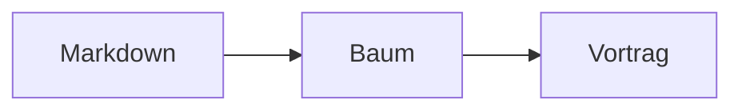

# Schritte und Animationen {id=schritte}

::: steps
- Erst das Problem
- Dann die Idee
- Zuletzt das Ergebnis
:::

::: notes
Schritte lassen Inhalte nacheinander erscheinen. Der einfachste Weg ist `::: steps` um eine Liste: Jeder Punkt wird ein Schritt. Im Vortrag geht → einen Schritt weiter, ← einen zurück. Im Lesemodus siehst du den Endzustand, ein Klick auf die Karte öffnet die Präsentation an dieser Stelle.

Schritte gibt es nicht nur für Listen: Codezeilen, Diagramme, Formelteile, Bilder, beliebige Blöcke, Tabellenzeilen und die Ebenen von Zeichnungen erscheinen auf dieselbe Weise. Gleiche Schrittnummer heißt immer „gleichzeitig“, auch über verschiedene Arten hinweg. Beim PowerPoint-Export werden Schritte zu Einblend-Animationen.
:::

## Listen {id=listen-schritte}

```md
## Agenda {steps}

- Problem
- Idee
- Ergebnis
```

::: notes
Mit `{steps}` an der Überschrift wird die erste Liste der Folie automatisch schrittweise eingeblendet, ohne Container. `::: steps start=2` lässt die Liste erst mit Schritt 2 beginnen, damit sie nach einem anderen Element kommt.
:::

## Code Zeile für Zeile {id=code-schritte}

```ts {steps="1|2|3"}
const tree = parse(markdown)
const plan = planFor(tree)
present(tree, plan)
```

::: notes
Codezeilen erscheinen mit `steps="1|2|3"` abschnittsweise: Der erste Abschnitt gilt ab Schritt 1, der zweite ab Schritt 2 und so weiter. Ein Abschnitt darf mehrere Zeilen nennen (`"1,6|2-3"`), Zeilen ohne Schritt bilden das Gerüst und stehen von Anfang an.

Mit `lines="2-3|5|all"` erscheint der Code ganz, und die genannten Zeilen werden nacheinander **hervorgehoben**, der Rest ist abgedunkelt. `all` hebt am Ende alles wieder auf.
:::

## Diagramme wachsen {id=diagramm-schritte}

````md

````

::: notes
Eine Zeile `%% step` im Mermaid-Code teilt das Diagramm in Versionen: Bis zur ersten Marke ist es sofort da, mit jedem Schritt kommt der nächste Teil dazu. Bei Flussdiagrammen (`flowchart`, `graph`) teilen sich alle Versionen das Layout der letzten: Beim Weiterschalten verschiebt sich nichts, Neues erscheint an seinem Platz (Knoten wachsen auf, Kanten zeichnen sich). Andere Diagrammarten zeichnet Hashmark je Version vollständig neu, dort kann sich die Anordnung ändern.
:::

## Blöcke, Bilder und Tabellen {id=reveal}

```md
::: reveal step=2
> [!TIP]
> Erscheint mit Schritt 2.
:::

{step=1 until=3}
```

::: notes
`::: reveal step=n` blendet **jeden** Block ein: Absatz, Tabelle, Bild, Hinweis oder Diagramm. Bilder können direkt `step=` tragen, `until=` blendet sie wieder aus. Fast alle Container kennen `step=` und `until=`, etwa Karten, Sprechblasen und Rahmen in Figuren.

Tabellen in `::: table steps=rows` erscheinen Zeile für Zeile, mit `steps=cols` Spalte für Spalte. Teile einer Formel erscheinen mit `\htmlData{step=2}{…}`, siehe Thema „Diagramme, Formeln, Medien“.
:::

## SVG, draw.io und Excalidraw {id=svg-schritte}

```md
{steps=ids}
{steps=layers}
{steps=groups order="3,1,2,4+5"}
```

::: notes
Zeichnungen bauen sich auf, ohne dass du sie zerlegst. In einem beliebigen SVG erscheinen Elemente mit `id="step-1"`, `id="step-2"` … ab ihrem Schritt (`steps=ids`). Bei einem draw.io-Export (`.drawio.svg`) wird jede **Ebene** ein Schritt (`steps=layers`), die erste ist sofort da. Bei einem Excalidraw-Export mit eingebetteter Szene werden die **Gruppen** zu Schritten (`steps=groups`); `order` legt die Reihenfolge fest, `+` heißt gleichzeitig. Ungruppierte Elemente bleiben sichtbar.
:::

## Effekte für Schritte {id=schritt-effekte}

```md
## Agenda {steps effect=up}
```

| Effekt | Wirkung |
| --- | --- |
| `fade` | blendet ein (Standard) |
| `up` | schwebt von unten ein |
| `left` | gleitet von links an den Platz |
| `scale` | wächst auf |
| `wipe` | wird von links nach rechts aufgedeckt |
| `highlight` | der neue Punkt leuchtet, solange er dran ist |
| `dim` | Früheres wird leiser, der aktuelle Punkt bleibt voll |

::: notes
`effect=` legt fest, *wie* ein Schritt erscheint. Du schreibst es an die Folie (`## Agenda {steps effect=up}`), an einen Container (`::: steps effect=scale`) oder fürs ganze Deck in die `deck.yaml` (`motion: { effect: up }`). Das Nächstliegende gilt: Container vor Folie vor Deck.

Mit `stagger` an einem Container (z. B. `::: cards stagger` mit `step=1` an jeder Karte) erscheinen Elemente derselben Schrittnummer im Abstand von 80 ms als kleine Welle. `delay=300ms` verzögert einen Auftritt. Das Tempo stellst du mit `speed=` ein, bei „Bewegung reduzieren“ im System entfällt der Weg und es wird nur überblendet. Im PDF, im Lesemodus und im PowerPoint-Export ändert sich nichts: Dort zählt der Endzustand bzw. das Einblenden.

**Bausteine, Zeichnungen und Diagramme** haben ohne `effect=` einen eigenen, zur Form passenden Auftritt: `process`, `pipeline`, `gantt` und `roadmap` werden von links nach rechts aufgedeckt, `timeline` gleitet von links, `kpis` wachsen als kleine Welle auf, `checklist` schwebt von unten, `pyramid` baut sich von unten auf. In Zeichnungen (draw.io, Excalidraw, SVG mit `steps=`) zeichnen sich die Linien jeder neuen Ebene bzw. Gruppe. In Mermaid-Diagrammen mit `%% step` wachsen neue Knoten auf und neue Kanten zeichnen sich. Mit `effect=fade` an der Folie, am Container oder im Deck (`motion: { effect: fade }`) schaltest du das ab, dann wird wie bisher eingeblendet. Bei Kennzahlen lässt das Flag `countup` die Zahlen beim Auftritt von 0 hochlaufen (`::: kpis countup steps`). Bei „Bewegung reduzieren“ im System gibt es auch hier nur Überblenden, und die Zahlen stehen sofort richtig da.
:::

## Übergänge {id=uebergaenge}

```md
## Demo {transition=zoom}
```

::: notes
Ohne Angabe sind die Übergänge **räumlich**, passend zum Baum: → und ← schieben die Folie seitlich, ein Sprung (Suche, Übersicht) blendet über. Bei ↓ und ↑ spürst du die **Tiefe**: Beim Abtauchen tritt der Elternknoten leicht zurück und dunkelt ab, das Detail kommt von unten darüber; mit ↑ kehrt sich das um. Mit `transition=` legst du den Wechsel **zu** dieser Folie fest:

- `slide` schiebt seitlich, `zoom` fährt hinein (der frühere Standard bei ↓ ↑), `fade` blendet über, `none` springt ohne Bewegung.
- `push` schiebt die alte Folie in Richtung der Taste hinaus, `depth` ist das Tiefengefühl von oben.
- `cover` legt die neue Folie über die alte, `reveal` zieht die alte weg, `blur` verschwimmt weich.
- `iris` öffnet einen Kreis von der Seite der Taste, `curtain` öffnet die alte Folie von der Mitte, `diagonal` baut die neue Folie als Welle aus Kacheln auf, `mosaic` setzt sie aus zufälligen Kacheln zusammen, `blinds` öffnet Streifen nacheinander.

Die auffälligen Übergänge (`iris`, `curtain`, `diagonal`, `mosaic`, `blinds`) sind für einzelne Folien gedacht, etwa einen Kapitelstart. Für das ganze Deck schreibst du in die `deck.yaml`: `motion: { transition: push }`; `transition=` an der Folie hat Vorrang. Beim PowerPoint-Export wird jeder Übergang durch den nächstliegenden von PowerPoint ersetzt.

**Tempo:** `{speed=slow}` macht den Wechsel zu dieser Folie ruhiger (760 ms, gut für den Auftritt eines Kapitels), `{speed=fast}` huscht in 190 ms vorbei, `normal` (380 ms) ist der Standard. Für das ganze Deck schreibst du in die `deck.yaml`: `motion: { speed: slow }`; `speed=` an der Folie hat Vorrang. Die Einblendungen der Schritte laufen im selben Tempo.

**Bewegung reduzieren:** Hat jemand im System „Bewegung reduzieren“ eingeschaltet, überblendet Hashmark jeden Wechsel kurz (120 ms) statt zu schieben oder zu zoomen. Das geschieht automatisch, du musst nichts einstellen.
:::

## Elemente wandern {id=auto-animate}

````md
## Architektur {morph=titel}

{morph=logo}

::: card morph=quote title="Quote"
94 %
:::

```ts {morph=code}
const baum = lesen(deck)
```
````

::: notes
**Auto-Animate** lässt ein Element, das auf der nächsten Folie wieder vorkommt, dorthin wandern, statt zu verschwinden und neu zu erscheinen.

- **Der Folientitel wandert von selbst.** Steht er auf der nächsten Folie an einer anderen Stelle oder in anderer Größe (z. B. von der Mitte der Titelfolie in die Ecke), fliegt er hin, auch mit anderem Text. Mit `{morph=off}` an der Folie oder `motion: { morph: off }` in der `deck.yaml` bleibt er, wo er ist.
- **`morph=name` benennt ein Element.** An Bildern (`{morph=logo}`), Containern wie Karten (`::: card morph=quote`), Code-Blöcken und der Überschrift. Trägt die nächste Folie ein Element mit demselben Namen, wandert es dorthin, in neuer Größe und an neuer Stelle. Das geht auch von einer Kapitelfolie in ihr Detail: Die Karte wird zur ganzen Folie. Ein Logo hat Hashmark nicht als eigenes Element, es wandert, wenn es einen Namen trägt.
- **Code-Blöcke mit gleichem Namen ordnen ihre Zeilen zu.** Gleiche Zeilen rutschen an ihren neuen Platz, neue blenden ein. So sieht man, was sich geändert hat.

Der Rest der Folie blendet kurz um. Bewegt sich nichts (alles an derselben Stelle), gilt der normale Übergang. Das Tempo stellst du mit `speed=` ein, bei „Bewegung reduzieren“ im System gibt es nur Überblenden. Im PDF, Druck und Lesemodus ändert sich nichts, beim PowerPoint-Export wird übergeblendet.
:::

## Bild, Code und Diagramm vergrößern {id=bild-zoom}

````md
{zoom}
````

::: notes
Mit `{zoom}` hinter dem Bild lässt es sich in der Präsentation vergrößern: **Z** oder ein Klick auf das Bild fährt die Kamera in die Folie hinein, bis das Bild die Bühne füllt. Titel und Text wandern dabei mit aus dem Bild, so bleibt der Zusammenhang sichtbar. **Z**, **Esc** oder ein Klick fährt zurück, Weiterblättern setzt die Kamera ebenfalls zurück. Die Presenter-View zeigt, ob die Folie ein Bild zum Vergrößern hat, und gibt Z weiter.

In der `deck.yaml` macht `zoom: true` alle Bilder des Decks vergrößerbar, `{zoom=off}` nimmt ein einzelnes Bild aus. Hat die Folie mehrere vergrößerbare Bilder, fährt Z auf das erste sichtbare, ein Klick auf ein bestimmtes Bild auf dieses. Wer die Bewegung nicht mag, stellt im Betriebssystem „Animationen reduzieren“ ein: Dann springt die Kamera ohne Fahrt. PDF, PowerPoint und Handout zeigen das Bild unverändert.

Wer nur mit → durchsteppt (auch aus dem Presenter), muss nicht an Z denken: `{zoomstep=2}` lässt die Kamera bei Schritt 2 von selbst aufs Bild fahren, `{zoomstep=2 zoomuntil=3}` fährt bei Schritt 3 wieder heraus (ohne `zoomuntil` bleibt sie, bis die Folie wechselt). ← kehrt jeden Schritt um. Der Zoom zählt als Schritt der Folie und steht in der Schrittanzeige; Z, Klick und Esc gehen zusätzlich weiter.

Tiefer hinein: **+** und **−** fahren eine Stufe tiefer bzw. wieder heraus, unter die Ausgangsgröße ist − der Weg zurück. Sobald die Kamera tiefer steht als beim ersten Z, verschieben die **Pfeiltasten** den Ausschnitt, und unten rechts zeigt eine **Minikarte**, wo man auf der Folie ist; Space und Bild ab gehen weiter, → blättert erst nach Esc oder Z. Das **Mausrad** zoomt am Zeiger, sobald die Kamera fährt, **Strg + Mausrad** (Spreizen auf dem Touchpad) startet sie auch. **Am Telefon oder Tablet** ohne Tastatur: Antippen eines Bildes, Codeblocks, Diagramms oder einer Tabelle fährt hinein, **zwei Finger spreizen** bzw. zusammenführen zoomt (auch aus der Normalansicht), **ein Finger** verschiebt den Ausschnitt. Unten links stehen die Schaltflächen **−**, **+** und **×** (Zoom beenden), unten rechts die Minikarte. Tippen auf die Folie fährt ebenfalls zurück. Zum Blättern ohne Tastatur **wischt** man auf der Folie nach links (weiter) bzw. rechts (zurück), solange die Kamera nicht fährt; das Steuerkreuz unten rechts ist auf Touchscreens fingergroß. In der Presenter-View gehören + und − der Kamera, solange sie fährt, sonst der Schrift der Notizen.

Auch **Codeblöcke, Mermaid-Diagramme und Tabellen** lassen sich vergrößern, ohne Angabe im Markdown: Z fährt auf das erste sichtbare Ziel (Bilder zuerst), ein Klick auf ein bestimmtes Ziel auf dieses.
:::
