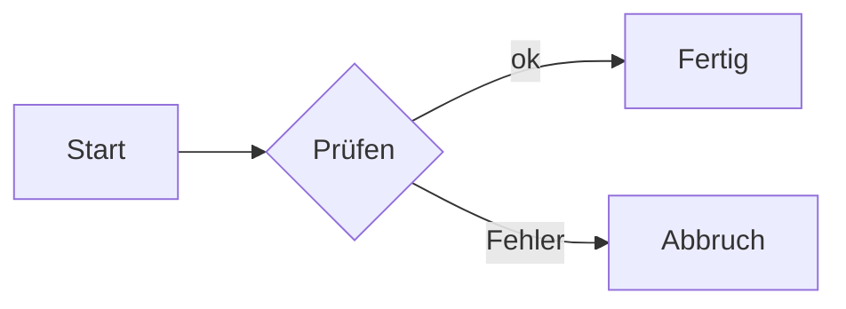

# Diagramme, Formeln, Medien {id=medien}

- **Formeln** in LaTeX, gesetzt mit KaTeX
- **Diagramme** in Mermaid, draw.io und Excalidraw
- **Code** mit Farben, **Video** und **QR-Codes**

::: notes
Alles, was eine technische Präsentation braucht, ist eingebaut und läuft offline: Formeln, Diagramme, Code-Hervorhebung, Videos und QR-Codes. Nichts wird von einem fremden Dienst geladen, die Schriften für Formeln liegen im Programm. Fehler in Formeln oder Diagrammen meldet „Prüfen“ (`make check`) mit Dateiname und Zeile.
:::

## Formeln {id=formeln}

$$
E = mc^2 \htmlData{step=1}{{}\quad\text{und}\quad} \htmlData{step=2}{e^{i\pi} + 1 = 0}
$$

::: notes
Formeln schreibst du in LaTeX: `$a^2$` im Satz, `$$ … $$` oder ein Codeblock `math` als eigener Block. Gesetzt werden sie mit KaTeX schon beim Laden des Decks. Teile einer Formel erscheinen schrittweise mit `\htmlData{step=2}{…}`, wie hier; ein ganzer `math`-Block mit `step=` und `until=`.

Das Beispiel-Deck „Formeln“ zeigt Mathematik, Statistik und Physik.
:::

## Mermaid {id=mermaid}

````md

````

::: notes
Diagramme schreibst du als Mermaid-Code: Flussdiagramme, Sequenzen, Zustände, Klassen, Zeitachsen und mehr. Die Farben kommen aus dem Theme. Flussdiagramme und Zustände kennen die Klassen `accent`, `ok`, `warn`, `bad`, `important`, `muted` und `actor`.

Attribute: `look=hand` zeichnet im Skizzenstil, `height=520` setzt die größte Höhe in Pixel (Standard 460), `align=left` richtet links aus. Mit `%% step` wächst das Diagramm schrittweise, siehe Thema „Schritte und Animationen“.
:::

## draw.io und Excalidraw {id=zeichnungen}

```md
{steps=layers}
{steps=groups}
```

::: notes
Zeichnungen aus draw.io und Excalidraw bindest du als SVG-Export ein wie ein Bild. Eine `.drawio.svg`-Datei enthält das Modell samt Ebenen von selbst; bei Excalidraw beim Export „Szene einbetten“ wählen. Dann kennt Hashmark Ebenen bzw. Gruppen und baut die Zeichnung schrittweise auf (`order=` legt bei Excalidraw die Reihenfolge fest). Ohne Schritte ist es ein normales Bild.
:::

## Code {id=code}

```ts {title="plan.ts" lines="1|2"}
const plan = planFor(tree)
present(tree, plan)
```

::: notes
Code wird beim Laden mit Shiki eingefärbt, in den Farben des Themes. `title=` setzt eine Beschriftung über den Block, `steps=` blendet Zeilen ein, `lines=` hebt sie nacheinander hervor (siehe Thema „Schritte und Animationen“). Im PowerPoint-Export bleibt Code bearbeitbarer Text mit Farben.
:::

## Video {id=video}

````md
{play=1 start=5s end=50s}
````

::: notes
Ein Video schreibst du wie ein Bild. Die Dateiendung (`.mp4`, `.m4v`, `.webm`, `.ogv`) macht es zum Video. Es steht als **Standbild** auf der Folie, der nächste **Schritt (→)** startet es, **K** hält es an und setzt es fort. Läuft es noch, springt → ans Ende (das letzte Bild bleibt), das nächste → geht weiter. Die Presenter-View zeigt, ob das Video läuft, und gibt K aus dem zweiten Fenster weiter.

Attribute: `play=2` startet erst mit Schritt 2 (`play=0` sofort mit der Folie), `start=` und `end=` schneiden einen Ausschnitt (`12`, `12.5`, `5s`, `1m30s`; ein Doppelpunkt wie `0:05` geht in der Attributklammer nicht), `loop` wiederholt ihn, `muted` schaltet den Ton ab, `poster=bild.png` ersetzt das Standbild. Mit `controls` zeigt das Video die Leiste des Browsers und ist kein Schritt. `width`, `fit`, `pos`, `step` und `until` gelten wie bei Bildern.

Das Video liegt als Datei im Deck-Ordner. Als Format empfehlen wir MP4 (H.264/AAC), das spielen Edge, Chrome, Safari und die Desktop-App unter Windows. WebM ist nicht überall gleich gut unterstützt, vor allem in Safari. Unter Linux und macOS ist die Wiedergabe in der Desktop-App noch nicht erprobt, unter Linux braucht der Webbetrachter vermutlich Systempakete (GStreamer). Videos von Webseiten und Einbettungen gibt es bewusst nicht, Hashmark läuft offline. Für einen Link eignet sich der QR-Code-Block. PDF und PowerPoint zeigen das Standbild.

Im Browser startet ein Video mit Ton erst, nachdem im Präsentationsfenster einmal geklickt oder eine Taste gedrückt wurde. Bis dahin zeigt das Video seine Abspielleiste, ein Klick startet es. In der Desktop-App gilt die Einschränkung nicht.
:::


## QR-Code {id=qr}

````md
```qr {size=220 label="Hashmark"}
https://goerks.github.io/Hashmark/
```
````

::: notes
Ein Codeblock `qr` macht aus einer Adresse einen QR-Code, ohne externen Dienst. `size=` ist die Kantenlänge in Pixel, `label=` die Beschriftung darunter. Der Code nimmt die Textfarbe des Themes an. Gut für die letzte Folie: Link zu den Unterlagen.
:::
