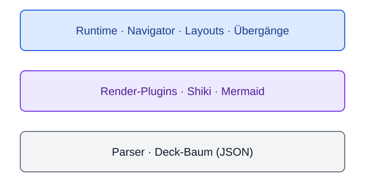
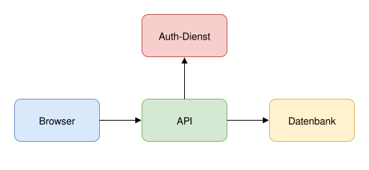

# Bilder

::: columns
::: col
### Datei einbinden
{width=100% zoom}

`{width=100% zoom}`
:::
::: col
### Base64 eingebettet
![Logo][logo]{width=180}

`![Logo][logo]` + am Dateiende
`[logo]: data:image/svg+xml;base64,…`
:::
:::

## So funktioniert's

- **Datei im Deck-Ordner** → wird beim Build mitkopiert
- **Datei außerhalb** (z. B. `../shared/logo.png`) → automatisch als Base64 eingebettet
- **`embedImages: true`** in `deck.yaml` → alle Bilder als Base64
- **`{width=60% height=200 .klasse}`** direkt hinter dem Bild
- **`{zoom}`** hinter dem Bild: in der Präsentation fährt **Z** (oder ein Klick) die Kamera aufs Bild, noch einmal Z zurück

## draw.io mit Ebenen

{steps=layers}

::: notes
Ebene 1 „Basis“ ist sofort da, „Daten“ kommt mit Schritt 1, „Sicherheit“ mit Schritt 2.
:::

[logo]: data:image/svg+xml;base64,PHN2ZyB4bWxucz0iaHR0cDovL3d3dy53My5vcmcvMjAwMC9zdmciIHdpZHRoPSIyNDAiIGhlaWdodD0iMjQwIiB2aWV3Qm94PSIwIDAgMjQwIDI0MCI+PHJlY3QgeD0iMjAiIHk9IjEzMCIgd2lkdGg9IjIwMCIgaGVpZ2h0PSI0MCIgcng9IjgiIGZpbGw9IiMyNTYzZWIiLz48cmVjdCB4PSI0NSIgeT0iODUiIHdpZHRoPSIxNTAiIGhlaWdodD0iNDAiIHJ4PSI4IiBmaWxsPSIjNjBhNWZhIi8+PHJlY3QgeD0iNzAiIHk9IjQwIiB3aWR0aD0iMTAwIiBoZWlnaHQ9IjQwIiByeD0iOCIgZmlsbD0iI2JmZGJmZSIvPjx0ZXh0IHg9IjEyMCIgeT0iMjE1IiBmb250LWZhbWlseT0iU2Vnb2UgVUksIEFyaWFsIiBmb250LXNpemU9IjI4IiBmb250LXdlaWdodD0iNzAwIiB0ZXh0LWFuY2hvcj0ibWlkZGxlIiBmaWxsPSIjMWUzYThhIj5TdHJhdGE8L3RleHQ+PC9zdmc+
