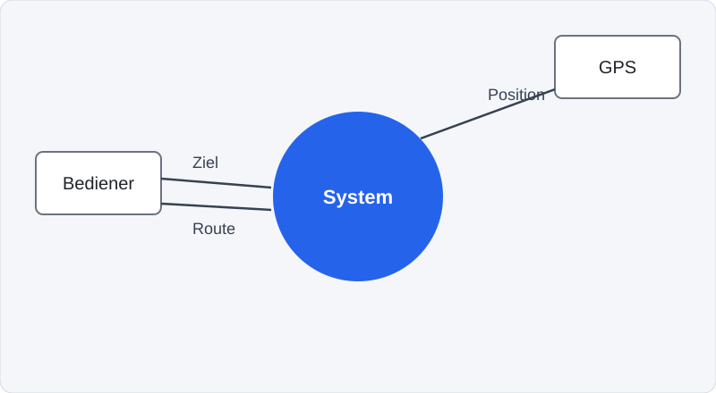
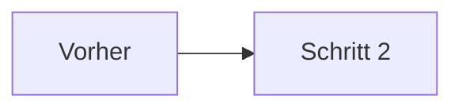
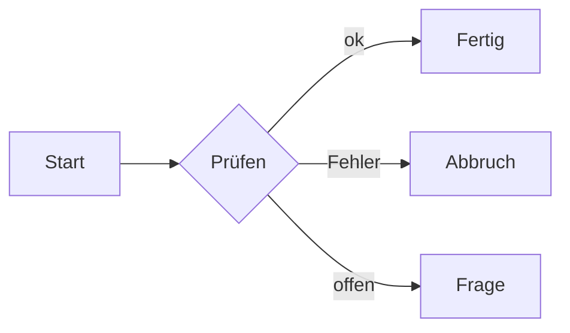

# Gestaltung {layout=section}

Bilder, Beschriftungen, Karten, Tabellen und Diagramme: alles aus Markdown, alles schrittweise einblendbar.

::: children
:::

## Bildband {layout=banner banner=bilder/banner.svg bannerh=210 bannerpos="50% 60%"}

Das Layout `banner` legt ein Bild als Band an den oberen Rand. Der Titel steht darunter.

```md
## Titel {layout=banner banner=bilder/foto.jpg bannerh=210 bannerpos="50% 60%"}
```

- `bannerh` ist die Höhe in px, `bannerpos` der Ausschnitt
- Eigene Layouts im Theme nutzen dasselbe Band (`.slide-banner`)

## Bilder zuschneiden und einblenden {layout=two-col fit}

::: col
Attribute direkt hinter dem Bild:

- `fit=cover|contain|fill`
- `pos="50% 20%"` (Ausschnitt)
- `ratio=16/9`
- `step=2`, `until=3`
- `width`, `height`, `.klasse`

```md
{fit=cover ratio=16/9 step=1}
```
:::

::: col
{fit=cover ratio=16/9 pos="50% 60%" step=1}

{fit=cover ratio=4/1 step=2}
:::

## Figur mit Beschriftungen {layout=default}

::: figure w=70


::: frame at="3,36" size="21,24" label="Akteur" step=1
:::

::: bubble at="40,5" w=34 tail=down step=2
Das **System** bleibt eine Blackbox.
:::

::: pin at="80,32" step=3
1
:::
:::

::: notes
Positionen sind Prozent der Figur (`at="x,y"`), Größe `size="b,h"` bzw. `w=`. Ohne `::: figure` gelten sie für die ganze Folie.
:::

## Karten {layout=default}

::: cards cols=3 steps
::: card icon=user title="Akteure"
Rollen, Personas, externe Systeme
:::
::: card icon=target title="Ziele"
Benutzerziel auf See-Level
:::
::: card icon=sitemap title="Use Cases"
Struktur und Umfang des Systems
:::
::: card icon=layers title="Slices"
Wertstiftende Teilmengen
:::
::: card icon=map title="Map"
Story Map und Roadmap
:::
::: card icon=check title="Tests"
Szenarien aus dem Ablauf
:::
:::

Icons: `user`, `target`, `sitemap`, `layers`, `map`, `check` und mehr (Liste in den Notizen). Jeder andere Wert, z. B. ein Emoji, erscheint unverändert.

::: notes
Icons: user users target clock check x alert star book gear link cloud flag list map layers scissors search lock card bank phone bulb file code chart arrow ball sitemap shield mail calendar coffee rocket puzzle heart
:::

## Tabellen mit Optionen {layout=default}

::: table widths="2:1:1:1" steps=rows hl="r2c3"
| Tool | Kontext | Use Case | Aktivität |
| --- | :---: | :---: | :---: |
| Draw.io | ★ | ★ | ★ |
| PlantUML | ✓ | ★ | ★ |
| Mermaid | ✓ | ★ | ✓ |
:::

`widths`, `steps=rows|cols`, `hl="r2c3,c1"` (Zeile, Spalte, 1-basiert, `r0` = Kopf)

## Beliebige Blöcke als Schritt {layout=default}

Der Text steht von Anfang an.

::: reveal step=1
> [!TIP] Schritt 1
> `::: reveal step=1` blendet **jeden** Block ein: Absatz, Tabelle, Bild, Hinweis.
:::

::: reveal step=2

:::

::: reveal step=3
Und zuletzt ein Absatz.
:::

## SVG als Schritte {layout=two-col}

::: col
Jedes SVG aus Inkscape, Figma oder von Hand: Elemente mit `id="step-N"` erscheinen ab Schritt N.

```md
{steps=ids}
```

```xml
<g id="step-1">…</g>
<g id="step-2">…</g>
```
:::

::: col
{steps=ids}
:::

## QR-Code {layout=two-col}

::: col
Aus einer Adresse entsteht ein QR-Code, ohne externen Dienst:

````md
```qr {size=220 label="Hashmark"}
https://example.com
```
````
:::

::: col
```qr {size=240 label="https://example.com"}
https://example.com
```
:::

## Mermaid: Theme-Klassen und Skizzenstil {layout=two-col}

::: col
Flussdiagramme und Zustände kennen die Klassen `accent`, `ok`, `warn`, `bad`, `important`, `muted`, `actor`:


:::

::: col
`{look=hand}` zeichnet im Skizzenstil:


:::

## Folienzahl und Fußzeile {layout=default}

In der `deck.yaml`:

```yaml
footer: Hashmark · Demo
slideNumber: "{n} / {total}"   # true = nur die Zahl
```

- Nummeriert wird in Baumreihenfolge, wie im PDF „Baum“
- `{footer=off}` an der Überschrift blendet sie auf einer Folie aus
- Titel-, Kapitel- und Statement-Folien zeigen keine Fußzeile
