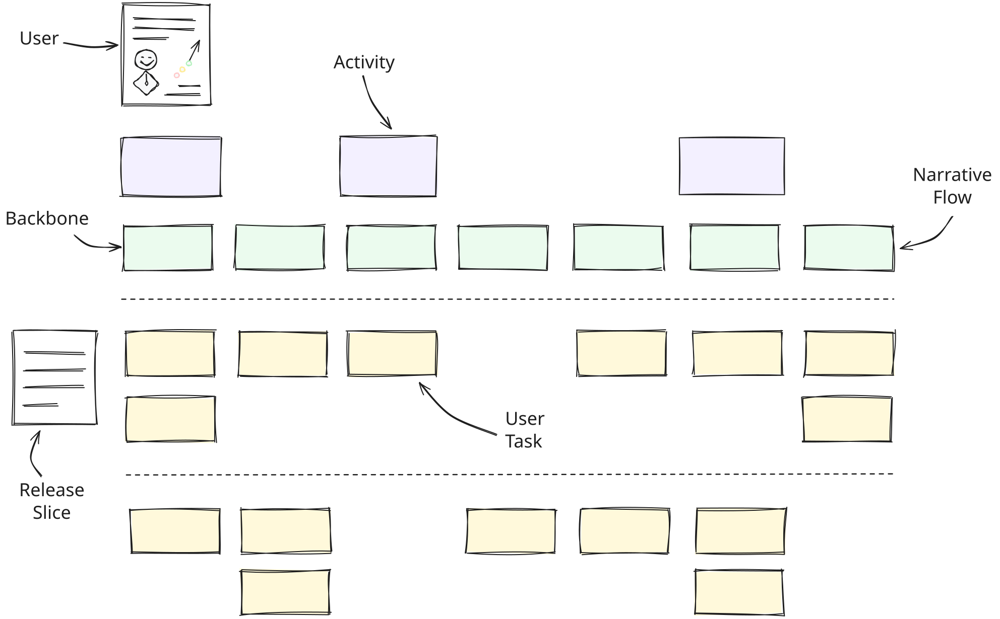

# Story Map {layout=default}

::: columns cols="1:3"
::: col
::: steps
- **Wer?** Die Nutzerin
- **Activities** ihre Ziele
- **Backbone** der Ablauf
- **Release 1** der erste Schnitt
- **Release 2** der zweite Schnitt
:::
:::

::: col
{steps=groups order="3,1,2,4+5,6"}
:::
:::

::: notes
Excalidraw-Export mit eingebetteter Szene. Die Gruppen der Zeichnung werden zu Schritten, `order` legt die Reihenfolge fest (Nummer = Gruppe in Z-Reihenfolge, `+` = gleichzeitig). Ungruppierte Elemente bleiben sichtbar.
:::
