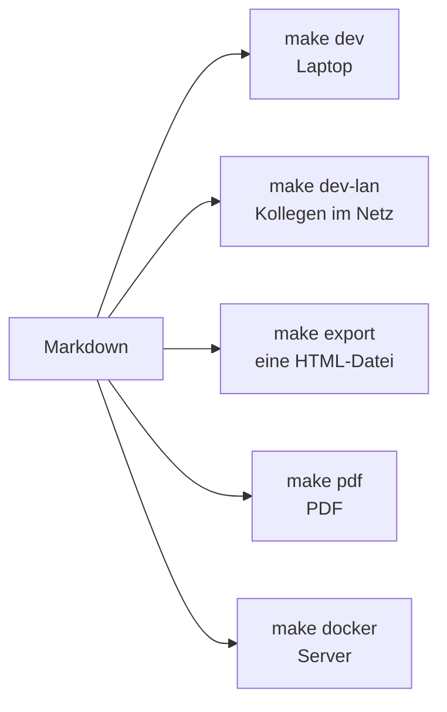

# Werkzeuge {layout=section}

Schreiben, vorführen, weitergeben – alles aus derselben Markdown-Quelle.

## Editor {layout=two-col}

::: col
::: steps
- Links Markdown, rechts Live-Vorschau
- Cursor und Vorschau laufen synchron
- Bilder per Drag & Drop oder Ctrl+V
- Autosave – die Folie bleibt stehen
:::
:::

::: col
```sh {title="Terminal" steps="1|2"}
make edit
make edit DECK=decks/mein-vortrag
```

Öffnet `localhost:3030/editor.html` – nur lokal erreichbar.
:::

::: notes
Kurz live zeigen: Tippen im Editor, Vorschau springt mit.
:::

## PDF und Druck {layout=two-col}

::: col
::: steps
- **Ctrl+P** druckt alle Folien – Seitenbereich im Dialog wählbar
- **P** öffnet die Druckansicht mit Optionen
- **make pdf** erzeugt das PDF ohne Dialog
:::
:::

::: col
```sh {title="Varianten" steps="1|2|3|4"}
make pdf           # alle Folien
make pdf DEPTH=1   # Hauptpfad
make pdf STEPS=1   # je Schritt
make pdf NOTES=1   # Handout
```
:::

---

**Im Detail**

| Eigenschaft | Umsetzung |
| --- | --- |
| Format | 16:9 wie PowerPoint, Handout A4 hoch |
| Reihenfolge | Kapitel, dann seine Details |
| Navigation | klickbare Querverweise, Lesezeichen nach Hierarchie |
| Papier | passt sich A4/Letter an, keine leeren Seiten |

## Präsentieren und teilen



::: notes
Export-Datei läuft offline per Doppelklick – ideal als Backup auf USB.
:::
