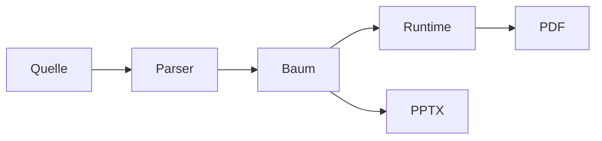

# Weitere Bausteine {layout=section}

Vorher/Nachher, Roadmap, Pyramide und Matrix als Komponenten, dazu vier Layouts.

## Vorher und Nachher

::: versus
::: before label="Vorher"
- Handarbeit, zwei Tage
- Fehler beim Kopieren
- Nur eine Person kennt den Ablauf
:::
::: after label="Nachher" step=1
- Pipeline, 20 Minuten
- Jedes Mal gleich
- Der Ablauf steht im Repository
:::
:::

::: notes
`::: versus` zeigt zwei Zustände mit Pfeil. „Nachher“ erscheint mit `step=1` erst im nächsten Schritt.
:::

## Roadmap

::: roadmap title="Roadmap 2027" today="41%" done=2 steps
- **Q1** Plugin-API
- **Q2** Theme v2
- **Q3** Animationen
- **Q4** Outliner
:::

::: notes
`today` setzt die „heute“-Linie in Prozent der Breite, `done` füllt die erledigten Phasen.
:::

## Pyramide

::: pyramid title="Schichten (von der Basis aus)" steps
- Infrastruktur
- Plattform
- Dienste
- Oberfläche
:::

::: notes
Der erste Listenpunkt ist die unterste Stufe. Mit `steps` wächst die Pyramide von unten nach oben, mit `inverted` wird daraus ein Trichter.
:::

## Matrix

::: matrix x="Aufwand" y="Nutzen" focus=2
- **Planen** groß, später
- **Zuerst** Quick Wins
- **Vermeiden** teuer, wenig Nutzen
- **Nebenbei** klein, bei Gelegenheit
:::

::: notes
Die Felder stehen von links oben nach rechts unten. `focus=2` hebt das zweite Feld hervor.
:::

# Layout: image-full {layout=image-full bg=banner.svg bgdim=0.35}

Ein Bild füllt die Folie, der Titel liegt darüber.

# Layout: split {layout=split}

- Links eine Farbfläche mit großem Titel
- Rechts der Inhalt
- Für Kapitelwechsel mit etwas Gewicht

# Layout: diagram {layout=diagram}

# Layout: two-col-wide {layout=two-col-wide}

Jede Überschrift ist ein Knoten. Die oberste Ebene ist der Hauptpfad, alles darunter sind Details, in die du mit ↓ eintauchst.

Der Text steht links, die Randspalte rechts.

::: aside title="Merke"
Space läuft dem **Vortragsplan** nach und überspringt Optionales.
:::
