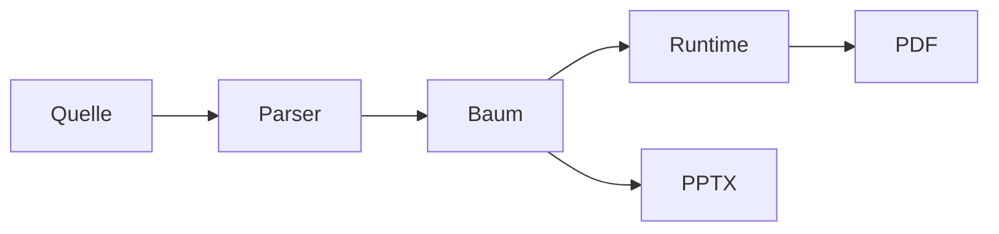

# Weitere Bausteine {layout=section}

Vorher/Nachher, Roadmap, Pyramide und Matrix als Komponenten, dazu vier Layouts.

## Vorher und Nachher

::: versus
::: before label="Vorher"
- Handarbeit, zwei Tage
- Fehler beim Kopieren
- Nur eine Person kennt den Ablauf
:::
::: after label="Nachher" step=1
- Pipeline, 20 Minuten
- Jedes Mal gleich
- Der Ablauf steht im Repository
:::
:::

::: notes
`::: versus` zeigt zwei Zustände mit Pfeil. „Nachher“ erscheint mit `step=1` erst im nächsten Schritt.
:::

## Roadmap

::: roadmap title="Roadmap 2027" today="41%" done=2 steps
- **Q1** Plugin-API
- **Q2** Theme v2
- **Q3** Animationen
- **Q4** Outliner
:::

::: notes
`today` setzt die „heute“-Linie in Prozent der Breite, `done` füllt die erledigten Phasen.
:::

## Pyramide

::: pyramid title="Schichten (von der Basis aus)" steps
- Infrastruktur
- Plattform
- Dienste
- Oberfläche
:::

::: notes
Der erste Listenpunkt ist die unterste Stufe. Mit `steps` wächst die Pyramide von unten nach oben, mit `inverted` wird daraus ein Trichter.
:::

## Matrix

::: matrix x="Aufwand" y="Nutzen" focus=2
- **Planen** groß, später
- **Zuerst** Quick Wins
- **Vermeiden** teuer, wenig Nutzen
- **Nebenbei** klein, bei Gelegenheit
:::

::: notes
Die Felder stehen von links oben nach rechts unten. `focus=2` hebt das zweite Feld hervor.
:::

## Balken mit Rechnung

::: bars title="Umsatz nach Region" scale=100 unit=" Mio." updated="2026-10-29" steps total
::: bar value=72 label="Nord"
:::
::: bar value="48,5" label="Süd" state=warn
:::
::: bar value=95 label="West"
:::
:::

::: notes
Die Komponente `bars` kommt aus `components/bars.html`. Die Vorlage rechnet: `{{ value | percent:scale }}` macht aus 72 die Balkenlänge, `{{ children | sum:value | number:1 }}` die Summe, `{{ updated | date:long }}` das Datum. Mit `state=warn` färbt `{{#if state is warn}}` den Balken um.
:::

## Pipeline

::: pipeline title="Release 4.2" summary steps
::: stage label="Bauen" state=done time="1:12 min"
:::
::: stage label="Testen" state=run progress=62
:::
::: stage label="Prüfen"
:::
::: stage label="Ausrollen"
:::
:::

::: notes
Jede Stufe hat einen Status: `done` (grün, voll), `run` (läuft, mit Fortschritt) oder `open`. Oben rechts rechnet die Vorlage mit `{{ children | share:state:done }}` den Anteil der erledigten Stufen aus, den Fortschritt der laufenden Stufe mit `{{ progress | percent }}`.
:::

## Statusautomat

::: states title="Freigabe-Prozess" back="Änderungen nötig"
::: state label="Entwurf" at=1 then=3
:::
::: state label="Prüfung" at=2 then=4
:::
::: state label="Freigabe" at=5
:::
::: state label="Veröffentlicht" at=6
:::
:::

::: notes
In jedem Schritt leuchtet ein anderer Zustand: `at=2` heißt „im zweiten Schritt“, `then=4` „und noch einmal im vierten“. So geht die Geschichte von Entwurf zur Prüfung, wieder zurück und dann zur Veröffentlichung. Die Vorlage setzt das „bis Schritt“ mit `{{ at | add:1 }}`.
:::

## Zeitplan

::: gantt title="Projektplan 2027" scale=12 now=6 from="Jan" to="Dez" steps
::: task label="Konzept" start=0 length=2 state=done
:::
::: task label="Bau" start=2 length=5 state=done
:::
::: task label="Test" start=6 length=3
:::
::: task label="Rollout" start=9 length=3
:::
:::

::: notes
Position und Breite der Balken rechnet die Vorlage aus `start`, `length` und `scale`: `{{ length | percent:scale:1 }}`. Die rote Linie steht bei `now=6`.
:::

## Checkliste

::: checklist title="Go-Live-Vorbereitung" progress steps
::: item label="Daten migrieren" state=done owner=Anna
:::
::: item label="Rechte prüfen" state=done owner=Ben
:::
::: item label="Schulung planen" state=wip owner=Chiara
:::
::: item label="Freigabe holen" owner=Ben
:::
:::

::: notes
Der Balken unten zeigt den Anteil der erledigten Aufgaben, `{{ children | count:state:done }} von {{ count }} erledigt` zählt sie. Beides rechnet die Vorlage selbst aus.
:::

# Layout: image-full {layout=image-full bg=banner.svg bgdim=0.35}

Ein Bild füllt die Folie, der Titel liegt darüber.

# Layout: split {layout=split}

- Links eine Farbfläche mit großem Titel
- Rechts der Inhalt
- Für Kapitelwechsel mit etwas Gewicht

# Layout: diagram {layout=diagram}

# Layout: two-col-wide {layout=two-col-wide}

Jede Überschrift ist ein Knoten. Die oberste Ebene ist der Hauptpfad, alles darunter sind Details, in die du mit ↓ eintauchst.

Der Text steht links, die Randspalte rechts.

::: aside title="Merke"
Space läuft dem **Vortragsplan** nach und überspringt Optionales.
:::
