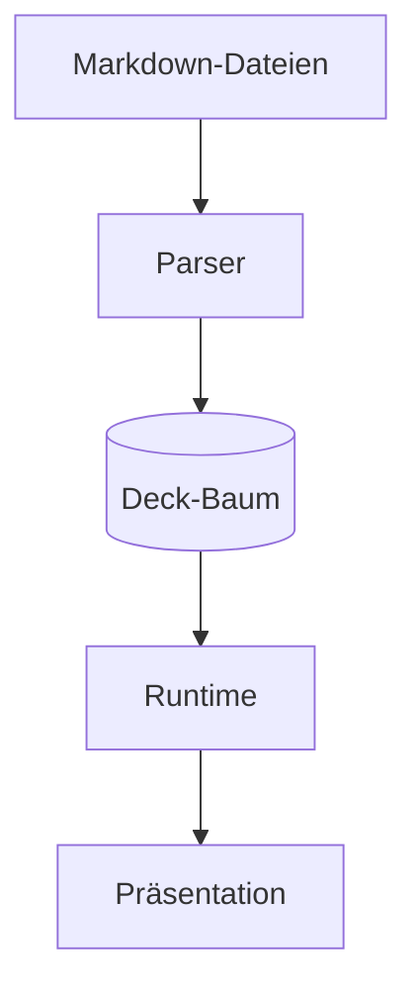

# Architektur {layout=two-col}

::: col
Der Kern ist ein framework-unabhängiger **Deck-Baum** als JSON.

- Parser: remark + Direktiven
- Plugins: Shiki, Mermaid
- Runtime: Svelte 5, Vite
:::

::: col

:::

## Parser {layout=section}

Aus 1..n Dateien entsteht ein Baum. Diese Folie hat Kinder aus einer eigenen Datei.

## Runtime


## Datenmodell {layout=default}

```ts {title="core/types.ts" lines="2-4|all"}
interface DeckNode {
  id: string            // Slug-Pfad, z. B. "architektur/parser"
  title: string
  depth: number
  attrs: Record<string, string>
  slides: Slide[]       // Sub-Slides (durch ---)
  children: DeckNode[]
}
```
