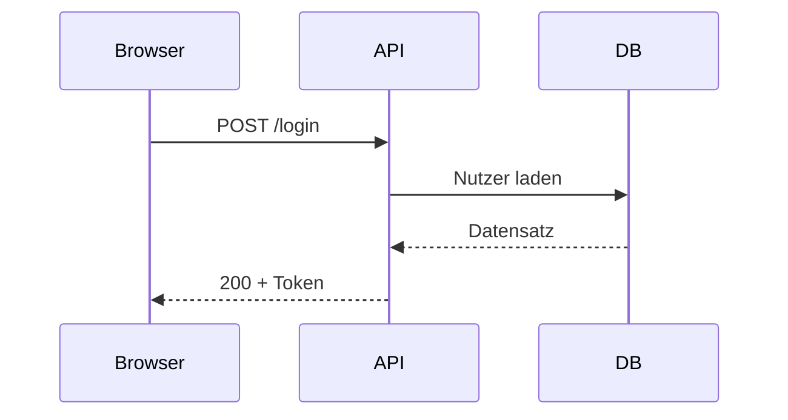

# Schritt für Schritt {layout=section}

Links aufzählen, rechts Code oder Diagramm vervollständigen – jedes → spielt den nächsten Schritt ab, erst danach kommt die nächste Folie.

## Code aufbauen {layout=two-col}

::: col
::: steps
- Funktion anlegen
- Zugangsdaten prüfen
- Token ausstellen
:::
:::

::: col
```ts {title="auth.ts" steps="1,6|2-3|4-5"}
export async function login(user: User) {
  const ok = await verify(user.password)
  if (!ok) throw new AuthError()
  const token = sign({ sub: user.id })
  return token
}
```
:::

## Diagramm aufbauen {layout=two-col}

::: col
::: steps
- Browser schickt Login
- API fragt die Datenbank
- Antwort mit Token
:::
:::

::: col

:::

## Syntax

```md
::: steps               ← jeder Listenpunkt = ein Schritt
- Erstens
- Zweitens
:::

```ts {steps="2|3-4||5"}   ← je | ein Schritt, leer = keine Änderung
                             Zeilen ohne Schritt sind sofort sichtbar

%% step                 ← in Mermaid: Diagramm wächst ab hier
```

Gleiche Schrittnummer = gleichzeitig. `::: steps start=2` beginnt später.
