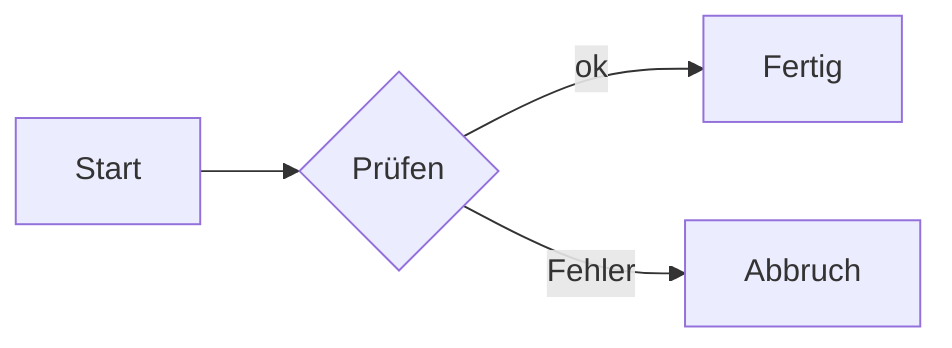
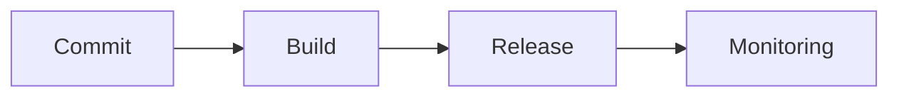

# Hashmark – Bauanleitung für KI

Diese Datei beschreibt vollständig, wie eine gültige Hashmark-Präsentation aufgebaut ist. Sie ist für KI-Assistenten geschrieben: Wer sie liest, kann ohne weitere Informationen ein Deck erzeugen, das lädt, prüft und vorgetragen werden kann.

Stand: abgeleitet aus dem Quelltext (`src/core/*`) und dem Handbuch (`docs/`). Bei Widerspruch gilt der Quelltext.

## 1. Grundidee in fünf Sätzen

1. Ein **Deck** ist ein Ordner mit einer oder mehreren Markdown-Dateien und einer optionalen `deck.yaml`.
2. Jede **Überschrift** (`#` … `######`) ist ein **Knoten** (eine Folie) in einem **Baum**. Die Ebene der Überschrift bestimmt die Tiefe.
3. Im Vortrag geht **→** auf der aktuellen Ebene weiter (Hauptpfad), **↓** taucht in die Details (Unterknoten), **↑** kehrt zurück.
4. Alles ist gewöhnliches Markdown (GFM: Tabellen, Listen, Code) plus **drei Ergänzungen**: Container `::: name`, Attribute `{…}` und Notizen `::: notes`.
5. Aussehen kommt aus Layout (pro Folie) und Theme (pro Deck), nicht aus dem Markdown.

## 2. Deck-Ordner

```
mein-deck/
├─ deck.yaml            optional
├─ 01-einstieg.md       Markdown-Dateien (alphabetisch, wenn kein mount)
├─ 02-thema.md
├─ bilder/              Bilder, Videos (Pfad relativ zur Markdown-Datei)
├─ components/          optional: eigene Container (HTML-Vorlagen)
└─ theme/               optional: eigenes CSS, Layouts
```

- Ohne `deck.yaml`: alle `*.md` im Ordner in alphabetischer Reihenfolge, Theme `minimal`, Titel = erste Überschrift.
- Dateiname ist bis auf Reihenfolge und eine Datei ohne Überschrift (dann Dateiname als Titel) bedeutungslos.
- Alle Pfade (Bilder, Videos) sind relativ zur Markdown-Datei, in der sie stehen.
- Es gibt keine externen Abhängigkeiten: keine CDN-Links, keine Web-Fonts, keine Fremddienste. Bilder per `https://` werden nicht eingebettet; lokale Dateien verwenden.

## 3. `deck.yaml`

Alle Schlüssel sind optional.

```yaml
title: Mein Vortrag              # Fenstertitel, PDF-Titel (sonst erste Überschrift)
theme: dark-tech                 # minimal | dark-tech | Pfad | Block (siehe unten)
maxDepth: 3                      # wie tief Überschriften Knoten sind (Code-Standard 6, Handbuch-Empfehlung 3)
layout: default                  # Standard-Layout aller Folien
layouts: { 1: section, 2: default }   # Layout je Ebene
duration: 25m                    # geplante Gesamtdauer (90s, 5m, 1h30m, 1:30, Zahl = Minuten)
footer: Firma · Vortrag          # Fußzeile auf jeder Folie
slideNumber: "{n} / {total}"     # true = nur Zahl, sonst Vorlage mit {n} und {total}
zoom: true                       # alle Bilder mit Z vergrößerbar
embedImages: true                # alle lokalen Bilder in die Ausgabe einbetten
embedMedia: true                 # Videos in Einzel-HTML einbetten (bis 25 MB)
mount:                           # Dateien und Reihenfolge
  - file: 01-einstieg.md
  - file: 02-thema.md
  - file: details/backend.md
    under: "Architektur > Backend"   # als Kinder unter bestehenden Knoten hängen
```

**Layout-Vorrang** je Knoten: `{layout=…}` an der Überschrift → `layouts` je Ebene → `layout` → `default`.

**`mount`-Regeln:**
- Fehlende Datei = Fehler.
- `under` nennt den Zielknoten als Titel oder Slug, Ebenen mit `>` getrennt, Groß/Klein egal. Das Ziel muss in einer **früheren** Mount-Datei stehen und darf nicht schon auf `maxDepth` liegen.
- Die oberste Überschriftenebene der gemounteten Datei wird eine Ebene unter das Ziel gelegt.

**`theme:` als Block:**

```yaml
theme:
  extends: minimal               # minimal | dark-tech | Pfad zu CSS oder Theme-Ordner
  tokens:                        # Design-Tokens, ohne führende --
    color-accent: "#e30613"
    font-heading: "Georgia, serif"
  layouts: ./theme/layouts       # Ordner (oder Liste) mit CSS: .layout-<name>
  css: ./theme/brand.css         # weitere CSS-Dateien (Datei oder Liste)
```

Tokens: `color-bg`, `color-fg`, `color-accent`, `color-heading`, `color-muted`, `color-surface`, `color-border`, `color-success`, `color-warning`, `color-important`, `color-danger`, `font-heading`, `font-body`, `font-code`, `radius`, `space-1` … `space-4`. Schriften nur aus dem System oder als Datei im Theme-Ordner (`@font-face`).

## 4. Der Baum: Überschriften → Knoten

- Die **oberste vorkommende Überschriftenebene jeder Datei** liegt auf Tiefe 1 (Hauptpfad), egal ob sie `#` oder `##` ist. Jede tiefere Ebene ist ein Kind des vorherigen Knotens.
- Tiefe 1 = Hauptpfad. Tiefe 2, 3 … = Details, die man per ↓ erreicht.
- Überschriften **tiefer als `maxDepth`** werden keine Knoten, sondern Zwischenüberschriften (`##`, `###` …) **innerhalb** der Folie des Elternknotens.
- Text **vor der ersten Überschrift** einer Datei gehört zum ersten Knoten der Datei.
- Eine Datei ohne Überschrift ergibt einen Knoten mit dem Dateinamen als Titel.
- YAML-Frontmatter (`---` am Dateianfang) wird ignoriert; Konfiguration steht in `deck.yaml`.

```md
# Architektur            ← Tiefe 1, Hauptpfad
## Parser                ← Tiefe 2, Detail von „Architektur“
## Runtime               ← Tiefe 2, → von „Parser“ geht hierher
### Hot Reload           ← Tiefe 3, Detail von „Runtime“
# Fazit                  ← Tiefe 1, → von „Architektur“ geht hierher
```

**Faustregeln für gute Decks:**
- Hauptpfad kurz halten (Vortrag entlang Ebene 1); Hintergrund und Belege in Ebene 2/3.
- Ein Gedanke pro Folie, Folien kurz. Erklärtext für den Vortragenden in `::: notes`, nicht auf die Folie.
- Mit `maxDepth: 3` arbeiten; mehr Tiefe wird unübersichtlich.

### 4.1 Adressen (IDs)

Jeder Knoten hat eine ID: `{id=…}`, sonst der Titel als Slug (klein, Bindestriche, Umlaute transliteriert). Doppelte Slugs unter demselben Eltern­knoten bekommen `-2`, `-3`. Der volle Pfad ist `eltern/kind`. Link im Text: `[Architektur](#architektur)`. Deep-Link: `…/#id`, auf Sub-Slide 2: `…/#id:2`.

### 4.2 Sub-Slides

Eine Zeile `---` (Leerzeile davor!) teilt **einen Knoten** in mehrere Sub-Slides. → blättert hindurch; sie zählen im Baum als ein Knoten. Notizen gehören zur Sub-Slide, in der sie stehen.

```md
## Ergebnis

Erste Ansicht

---

Zweite Ansicht, gleicher Knoten
```

Hinweise: `---` direkt unter einer Textzeile wäre in CommonMark eine Überschrift; Hashmark behandelt es trotzdem als Trenner. Ein `---` am Ende des Knotens erzeugt keine leere Folie. Eine leere **erste** Sub-Slide (nur Titel, dann `---`) ist erlaubt.

## 5. Attribute an Überschriften

Syntax: am Zeilenende in geschweiften Klammern, durch Leerzeichen getrennt.

```md
## Demo {layout=two-col transition=zoom duration=3m}
## Titel {id=meine-marke .wichtig}
## Liste {steps}
## Notiz {bg="linear-gradient(#123,#456)" bgdim=0.4}
```

Formate: `key=wert`, `key="wert mit Leerzeichen"`, `.klasse` (CSS-Klasse), `#id`, Flag ohne Wert (`steps`, `fit`, `optional`, `appendix`).

**Wichtig – wann `{…}` Attribute sind:** Der Block gilt nur als Attributblock, wenn er mindestens ein `=`, `.`, `#` oder eines der Flags `steps`, `fit`, `optional`, `appendix` enthält; sonst bleibt er Titeltext. Der Block muss am **Ende** der Überschrift stehen. **Ein Doppelpunkt im Wert ist verboten** (er zerreißt den Wert): `ratio=16/9`, `start=5s`, nicht `16:9`, `0:05`.

| Attribut | Wirkung |
| --- | --- |
| `layout=…` | Layout der Folie (siehe 6) |
| `id=…` | eigene Sprungmarke |
| `.klasse` | CSS-Klasse an der Folie |
| `transition=slide\|zoom\|fade\|none` | Übergang **zu** dieser Folie |
| `duration=5m` | geplante Redezeit (`90s`, `5m`, `1h`) |
| `bg=…` | Hintergrund: Farbe (`#123`, `red`), Verlauf (`linear-gradient(…)`) oder Bildpfad |
| `bgdim=0.5` | Hintergrundbild abdunkeln (0 bis 1) |
| `steps` | erste Liste der Folie schrittweise einblenden |
| `fit` / `fit=off` | Inhalt auf die Folie einpassen (höchstens auf 70 %) / abschalten |
| `optional` | Rolle „Optional“: Space überspringt, ↓ startet Ausflug |
| `appendix` | Rolle „Anhang“: nur über Suche und Übersicht |
| `plan=path\|optional\|appendix` | Rolle explizit (gilt für den ganzen Unterbaum) |
| `banner=bild.jpg` | Bildband (nur mit `layout=banner`) |
| `bannerh=210` | Höhe des Bildbands (px) |
| `bannerpos="50% 30%"` | Ausschnitt des Bildbands |
| `footer=off` | Fußzeile auf dieser Folie ausblenden |

Unbekannte Attribute erzeugen eine Warnung, unbekannte Layouts einen Fehler (`hashmark check`).

## 6. Layouts

Setzen mit `{layout=name}`. Standard ist `default`.

| Layout | Zweck / Inhaltserwartung |
| --- | --- |
| `title` | Titelfolie, groß und mittig (Titel + Untertitelzeile) |
| `section` | Kapitelfolie, zeigt automatisch Kacheln der Unterknoten |
| `default` | Überschrift und Inhalt |
| `statement` | Kernaussage, groß und mittig |
| `quote` | Zitat (`> Text` und Quelle) |
| `agenda` | Agenda aus den Kapiteln (Tiefe-1-Knoten, ohne `title`/`agenda`), aktuelles markiert; wird automatisch erzeugt |
| `two-col` | zwei Spalten (Inhalt in `::: columns`/`::: col` oder Layout-Aufteilung) |
| `three-col` | drei Spalten |
| `two-col-wide` | Text links, schmale Randspalte rechts (`::: aside title="…"`) |
| `comparison` | Gegenüberstellung |
| `split` | links Farbfläche mit Titel, rechts der Inhalt |
| `code-focus` | Code im Mittelpunkt |
| `image-left` / `image-right` | Bild links bzw. rechts, Text daneben |
| `image-full` | Bild füllt die Folie (`bg=bild`), Titel darüber |
| `banner` | Bildband oben (`banner=`), Inhalt darunter |
| `diagram` | kleiner Titel, das Diagramm füllt den Rest |

Eigene Layouts: CSS mit Selektor `.layout-<name>` im Theme (`theme.layouts`), dann `{layout=<name>}`.

Typischer Aufbau: Titelfolie `{layout=title}`, danach Agenda `{layout=agenda}`, Kapitel als Tiefe-1-Knoten (`layouts: { 1: section }` in der `deck.yaml` macht sie zu Kapitelfolien), Inhalt als Tiefe 2.

## 7. Container (`:::`)

Syntax im Pandoc-Stil. Öffnen mit `::: name attribute`, schließen mit `:::` auf eigener Zeile. Verschachtelung ist beliebig; **es genügen immer drei Doppelpunkte** (Hashmark rechnet die Länge selbst um). Innerhalb von Codeblöcken (```) werden Container nicht ausgewertet.

```md
::: columns cols="2:1"
::: col
Links, doppelt so breit
:::
::: col
Rechts
:::
:::
```

Attribute stehen direkt hinter dem Namen ohne Klammern (`::: cards cols=3 steps`); `{…}` ist ebenfalls erlaubt. Jeder Container muss geschlossen werden (sonst Warnung).

| Container | Zweck | Attribute |
| --- | --- | --- |
| `columns` | Spalten nebeneinander | `cols=3` oder `cols="2:1"` |
| `col` | eine Spalte (in `columns`) | – |
| `grid` | Raster | `cols=`, `gap=1rem` |
| `steps` | Liste Punkt für Punkt | `start=` |
| `reveal` | **beliebigen** Block ab Schritt n einblenden | `step=` (Pflicht), `until=` |
| `notes` | Sprechernotizen (nicht auf der Folie) | `step=` |
| `children` | Kacheln der Unterknoten | – |
| `table` | Markdown-Tabelle formatieren | `widths="2:1:1"`, `steps=rows\|cols`, `start=`, `hl="r2c3,c1"` (1-basiert, `r0` = Kopfzeile) |
| `cards` | Karten im Raster | `cols=`, `gap=`, `steps`, `start=` |
| `card` | eine Karte | `icon=`, `title=`, `accent=`, `step=`, `until=` |
| `figure` | Bild mit frei platzierten Beschriftungen | `w=` (Prozent) |
| `bubble` | Sprechblase (in `figure`) | `at="x,y"`, `w=`, `tail=left\|right\|up\|down`, `step=`, `until=` |
| `frame` | Rahmen (in `figure`) | `at="x,y"`, `size="b,h"`, `w=`, `label=`, `step=`, `until=` |
| `pin` | nummerierte Markierung (in `figure`) | `at="x,y"`, `step=`, `until=` |

Positionen (`at`, `size`, `w`) sind **Prozent der Figur** (bzw. der Folie ohne `figure`).

Fast alle Container akzeptieren zusätzlich `step=`, `until=`, `class=`, `id=`.

**Karten-Beispiel:**

```md
::: cards cols=3 steps
::: card icon=user title="Akteure"
Rollen und Personas
:::
::: card icon=rocket title="Start"
Erste Schritte
:::
:::
```

Eingebaute Icons: `user users target clock check x alert star book gear link cloud flag list map layers scissors search lock card bank phone bulb file code chart arrow ball sitemap shield mail calendar coffee rocket puzzle heart`. Jeder andere Wert (z. B. ein Emoji) erscheint unverändert.

**Figur-Beispiel:**

```md
::: figure w=70


::: frame at="3,36" size="21,24" label="Akteur" step=1
:::
::: bubble at="40,5" w=34 tail=down step=2
Das **System** bleibt eine Blackbox.
:::
::: pin at="80,32" step=3
1
:::
:::
```

### 7.1 Eingebaute Komponenten (Container mit Vorlage)

| Container | Aufbau | Attribute / Flags |
| --- | --- | --- |
| `timeline` | Zeitstrahl aus Liste | `title`, `start`; Flags `vertical`, `steps` |
| `process` | Prozess-Chevrons aus Liste | `title`, `start`; Flag `steps` |
| `kpis` | Kennzahl-Kacheln, Kinder `::: kpi` | `title`, `start`; Flag `steps`. Kind `kpi`: `value` (Pflicht), `label`, `trend=up\|down\|flat`, `delta`, `step` |
| `person` | Profilkarte, Rumpf = Beschreibung | `name` (Pflicht), `role`, `photo` |
| `roadmap` | Phasen mit „heute“-Linie aus Liste | `title`, `today="41%"`, `done=2`, `start`; Flag `steps` |
| `pyramid` | Schichten aus Liste, erste Zeile = Basis | `title`, `start`; Flags `steps`, `inverted` |
| `matrix` | Vierfelder-Matrix aus Liste (4 Einträge, links oben → rechts unten) | `title`, `x`, `y`, `focus=1..4`, `start`; Flag `steps` |
| `versus` | Vorher/Nachher, Kinder `::: before`/`::: after` | `title`; Kinder: `label`, `step` |
| `aside` | Randspalte für `two-col-wide` | `title` |
| `pipeline` | Ablauf in Stufen, Kinder `::: stage` | `title`, `start`; Flags `steps`, `summary` (Anteil erledigt). Kind `stage`: `label` (Pflicht), `state=done\|run\|open`, `progress` (für `run`, Standard 50), `time`, `step` |
| `states` | Statusautomat, Kinder `::: state`; je Schritt leuchtet ein Zustand | `title`, `back` (Beschriftung des Rückwegs). Kind `state`: `label` (Pflicht), `at` (Schritt, in dem er leuchtet), `then` (zweiter Schritt) |
| `gantt` | Zeitplan, Kinder `::: task` | `title`, `scale` (Länge der Zeitleiste, Standard 12), `now` („heute“-Linie), `from`, `to`, `start`; Flag `steps`. Kind `task`: `label`, `length` (Pflicht), `start` (Standard 0), `state=done\|open`, `step` |
| `checklist` | Checkliste, Kinder `::: task` | `title`, `start`; Flags `steps`, `progress` (Balken „n von m erledigt“). Kind `task`: `label` (Pflicht), `state=done\|wip\|open`, `owner`, `step` |

```md
::: timeline title="Roadmap" steps
- **Q1** Erster Meilenstein
- **Q2** Zweiter Meilenstein
:::

::: kpis steps
::: kpi value="87 %" label="Zufriedenheit" trend=up delta="+4 %"
:::
::: kpi value="42" label="Teams"
:::
:::

::: versus title="Release"
::: before label="Vorher"
- Handarbeit
:::
::: after label="Nachher" step=1
- Pipeline
:::
:::

::: person name="Anna Beispiel" role="Product Owner" photo=anna.svg
Verantwortet das Backlog.
:::

::: pipeline title="Release" summary
::: stage label="Bauen" state=done
:::
::: stage label="Testen" state=run progress=62
:::
::: stage label="Ausrollen"
:::
:::

::: states title="Freigabe" back="Änderungen nötig"
::: state label="Entwurf" at=1 then=3
:::
::: state label="Prüfung" at=2
:::
:::

::: gantt scale=12 now=6 steps
::: task label="Bau" start=2 length=5
:::
:::

::: checklist title="Go-Live" progress
::: task label="Daten migrieren" state=done
:::
::: task label="Freigabe holen"
:::
:::
```

### 7.2 Eigene Komponenten

Datei `components/<name>.html` im Deck- oder Theme-Ordner macht `::: <name>` verfügbar (optional `<name>.css` daneben; Wrapper-Klasse `.d-<name>`). Eingebaute Container (`cards`, `notes`, `columns` …) können nicht überschrieben werden; Deck-Ordner schlägt Theme-Ordner schlägt eingebaute Komponenten.

Vorlage (kein JavaScript, aber fertige Funktionen):

| Platzhalter | Bedeutung |
| --- | --- |
| `{{ attr }}` | Attribut des Containers als Text |
| `{{{ body }}}` | Inhalt als gerendertes Markdown (drei Klammern!) |
| `{{ foto\|image }}` | Attribut als Bildadresse |
| `{{ wert\|percent:max }}` | Attribut durch eine Funktion schicken, Argumente nach `:`, verkettbar: `{{ children\|sum:value\|number:1 }}` |
| `{{#if state is warn}}` | Vergleich mit festem Wert: `is`, `is not`, bei Zahlen auch `>`, `>=`, `<`, `<=` |
| `{{#if attr}} … {{else}} … {{/if}}` | nur wenn gesetzt |
| `{{#each items}} … {{/each}}` | je Listenpunkt: `{{{ html }}}`, `{{ text }}`, `{{ number }}`, `{{ index }}`, `{{ first }}`, `{{ last }}`, `{{ step }}`, `{{ count }}` |
| `{{#each children}} … {{/each}}` | je Kind-Container mit dessen Attributen, `{{{ body }}}`, `{{ number }}`, `{{ step }}` |
| `{{!meta … }}` (YAML, am Dateianfang) | Beschreibung: `description`, `attrs`, `flags`, `required`, `defaults` (Standardwerte fehlender Attribute), `example`, `children` |

Funktionen (Namen englisch; sie laufen beim Bauen, PDF und PPTX sehen gleich aus):

| Funktion | Ergebnis |
| --- | --- |
| `default:"–"` | Ersatzwert, wenn leer oder fehlend |
| `percent:max` / `percent:100:1` | Wert ÷ Gesamtwert in Prozent (`72` bei 96 → `75%`), optional Nachkommastellen; punkt-dezimal, taugt für `width:` |
| `number:1` / `number:1:"en"` | Zahl mit Nachkommastellen, Standard deutsch (`1.234,6`), zweites Argument ist die Sprache |
| `date:long` / `date:short:"en"` | Datum `JJJJ-MM-TT` → Text; `short`, `medium`, `long`, `month`, `iso` |
| `sum:feld`, `max:feld`, `min:feld` | über `children` oder `items` (Feld `text`) |
| `count:feld:wert` | Zahl der Kinder, bei denen das Feld gleich `wert` ist |
| `share:feld:wert` | Anteil dieser Kinder in Prozent (`50%`) |
| `add:1` | Zahl addieren |
| `upper`, `lower`, `truncate:40`, `image` | Text umformen bzw. Bildadresse auflösen |

Zahlen werden tolerant gelesen (`1.234,5`, `1,5`, `72 %`). Ein Name als Argument ist ein Attribut (`percent:scale`), Text steht in Anführungszeichen. Fehler in der Vorlage meldet `hashmark check` mit Zeile, Fehler beim Rechnen (z. B. keine Zahl) als Hinweis. Kein freies JavaScript. Ein Attribut ohne Wert (`::: timeline vertical`) gilt als gesetzt.

## 8. Schritte (Animationen innerhalb einer Folie)

Eine Folie hat Schritte 0..n. → blendet den nächsten ein, ← zurück. **Gleiche Schrittnummer = gleichzeitig**, auch über verschiedene Elementarten hinweg. Die Schrittzahl ist die höchste vorkommende `step`-Nummer. Bei PowerPoint-Export werden Schritte zu Einblend-Animationen, im PDF/Lesemodus ist der Endzustand sichtbar.

| Mittel | Syntax |
| --- | --- |
| Liste automatisch | `## Titel {steps}` (erste Liste) oder `::: steps` um die Liste (`start=2`) |
| beliebiger Block | `::: reveal step=2` … `:::` (`until=3` blendet wieder aus) |
| Bild | `{step=1 until=3}` |
| Container | `step=`/`until=` an fast jedem Container |
| Code Zeile für Zeile | ```` ```ts {steps="1\|2-3\|5"} ```` |
| Code hervorheben | ```` ```ts {lines="2-3\|5\|all"} ```` |
| Mermaid wächst | Zeile `%% step` im Diagramm trennt Versionen |
| Tabelle | `::: table steps=rows` (oder `cols`) |
| Formelteil | `\htmlData{step=2}{…}` in LaTeX; ganzer `math`-Block mit `{step=2}` |
| SVG | `{steps=ids}` mit Elementen `id="step-1"`, `id="step-2"` … |
| draw.io | `{steps=layers}` (jede Ebene ein Schritt, erste sofort) |
| Excalidraw | `{steps=groups order="3,1,2+4"}` (Szene eingebettet; `+` = gleichzeitig) |
| Video | `play=1` startet mit Schritt 1 (`play=0` sofort) |
| Zoom-Kamera | `{zoomstep=2 zoomuntil=3}` am Bild |

Code-Abschnitte: `|` trennt Schritte, `,` mehrere Zeilen, `-` Bereich (`"1,6|2-3"`); Zeilen ohne Schritt stehen von Anfang an; `all` hebt die Hervorhebung auf.

## 9. Bilder, Video, Code, Formeln, Diagramme

### Bilder

```md
{width=60% fit=cover ratio=16/9 pos="50% 20%" step=1 zoom}
```

Attribute: `width`, `height`, `fit=cover|contain|fill`, `pos`, `ratio` (mit `/`!), `step`, `until`, `zoom`/`zoom=off`, `zoomstep`, `zoomuntil`, `.klasse`. Fehlende Datei = Warnung. Referenz-Bilder (`![Logo][logo]` mit `[logo]: data:image/png;base64,…` am Dateiende) funktionieren dateiweit.

### Video

Ein Bild mit Endung `.mp4 .m4v .webm .ogv` ist ein Video. Attribute: `play=n`, `start=5s`, `end=1m30s`, `loop`, `muted`, `poster=bild.png`, `controls`, plus `width`/`fit`/`pos`/`step`/`until`. Zeiten ohne Doppelpunkt (`5s`, `1m30s`, `12.5`). Kein Einbetten von Web-Videos (offline).

### Code

````md
```ts {title="plan.ts" steps="1|2|3" lines="2-3|5|all"}
const tree = parse(markdown)
```
````

Farbliche Hervorhebung für jede Shiki-Sprache (`ts js bash yaml json css html python md …`). Unbekannte Sprachen werden als Text gesetzt.

### Formeln (KaTeX)

`$a^2$` im Satz, `$$ … $$` als Block oder Codeblock ` ```math ` (mit `{step=2 until=3}`). Offline, kein Mathematikfehler wird verschluckt: `hashmark check` meldet ihn.

### Diagramme

````md

````

Klassen für Flussdiagramme/Zustände: `accent ok warn bad important muted actor`. Farben kommen aus dem Theme. `.drawio.svg` und `.excalidraw.svg` bindet man wie Bilder ein.

### QR-Code

````md
```qr {size=220 label="Unterlagen"}
https://example.org/unterlagen
```
````

### Hinweiskästen

```md
> [!NOTE]
> Information

> [!TIP] Eigener Titel
> Tipp
```

Typen: `NOTE`, `TIP`, `IMPORTANT`, `WARNING`, `CAUTION`.

## 10. Notizen

```md
::: notes
Das sage ich zur Folie. Markdown ist erlaubt.
:::

::: notes step=2
Das sage ich ab Schritt 2.
:::
```

Auch erlaubt: alles nach einer Zeile `<!-- notes -->` bis zur nächsten Sub-Slide-Grenze ist Notiz. Notizen erscheinen in der Presenter-View, im Handout neben der Folie und im Lesemodus (`?reader`) als Fließtext. **Gute Praxis:** den erklärenden Text in Notizen schreiben, die Folie selbst knapp halten.

## 11. Vortragsplan und Zeit

Jeder Knoten hat eine Rolle: **Pfad** (Standard; Space läuft durch), **Optional** (Space überspringt, ↓ startet einen Ausflug mit automatischer Rückkehr), **Anhang** (nur über Suche/Übersicht, im Handout als eigener Teil). Gesetzt durch `{optional}`, `{appendix}`, `{plan=…}`; gilt für den ganzen Unterbaum. `duration=` je Knoten und `duration:` im Deck erlauben Zeitsummen und Tempoanzeige.

Bedienung (nur zur Orientierung): → ← Schritt/Folie, ↓ ↑ Ebene, Space dem Plan nach, S Presenter-View, P Plan, O Übersicht, Strg+K Suche, Z Zoom, B Beamer schwarz, T Plan aus.

## 12. Prüfen und Ausgeben

Befehle (CLI `hashmark`, im Projekt über `make`):

| Zweck | CLI |
| --- | --- |
| Dev-Server mit Live-Vorschau | `hashmark dev <deck>` |
| Editor im Browser | `hashmark edit <deck>` |
| statisches HTML | `hashmark build <deck>` |
| Einzel-HTML | `hashmark export <deck>` |
| PDF (Pfad/Baum/gruppiert) | `hashmark pdf <deck>` |
| PowerPoint | `hashmark pptx <deck>` |
| **Prüfen** | `hashmark check <deck>` (Exit 1 bei Fehlern) |

`hashmark check` meldet: unbekannte Layouts (Fehler), unbekannte Attribute und Übergänge (Warnung), fehlende Bilder, ungültige Dauern, ungültige Plan-Rollen, `banner` ohne Bild, Container-/Komponentenfehler, Formel- und Diagrammfehler, Überlauf von Folien.

## 13. Checkliste für eine gültige Präsentation

1. Ordner mit mindestens einer `.md`-Datei, die mindestens eine Überschrift hat.
2. Überschriften mit steigenden Ebenen; keine Ebenen überspringen (nach `#` kommt `##`, nicht `###`).
3. Attribute nur aus Abschnitt 5, am **Zeilenende** der Überschrift, **ohne Doppelpunkt im Wert**.
4. Nur Layouts aus Abschnitt 6 (oder im Theme definierte) verwenden.
5. Jeder `:::`-Container ist geschlossen, jeder Name ist in Abschnitt 7 aufgeführt oder als Komponente vorhanden; Attribute passen zum Container.
6. `---` mit Leerzeile davor und danach als Sub-Slide-Trenner (nicht als Absatzlinie gemeint).
7. Bilder und Videos existieren relativ zur Datei; `ratio=16/9`, nicht `16:9`.
8. Codeblöcke und Formeln sind geschlossen; Mermaid ist syntaktisch gültig.
9. Notizen in `::: notes`, nicht in die Folie.
10. `deck.yaml` ist gültiges YAML; `mount`-Dateien existieren, `under` verweist auf einen früheren Knoten.
11. Am Ende `hashmark check <deck>` laufen lassen und alle Fehler beheben.

## 14. Kompaktes Beispiel

`deck.yaml`:

```yaml
title: Produktstrategie 2027
theme: dark-tech
maxDepth: 3
duration: 20m
layouts: { 1: section }
footer: Strategie 2027
slideNumber: "{n} / {total}"
```

`01-vortrag.md`:

````md
# Produktstrategie 2027 {layout=title}

Wohin wir wollen – und warum

# Agenda {layout=agenda}

# Ausgangslage {duration=4m}

Wir wachsen, aber die Kosten wachsen schneller.

## Zahlen {layout=default}

::: kpis steps
::: kpi value="+18 %" label="Umsatz" trend=up delta="+4 %"
:::
::: kpi value="+31 %" label="Kosten" trend=down
:::
:::

::: notes
Umsatz und Kosten getrennt erklären; Kosten erst im zweiten Schritt.
:::

## Ursachen {optional}

- Sonderlösungen je Kunde
- Manuelle Releases

# Strategie {duration=8m}

## Drei Hebel {layout=two-col}

::: columns
::: col
### Standardisieren
Eine Plattform statt vieler Lösungen.
:::
::: col
### Automatisieren

:::
:::

---

> [!TIP] Kurz gesagt
> Weniger Varianten, mehr Automatisierung.

## Roadmap

::: roadmap title="2027" today="30%" done=1 steps
- **Q1** Plattform
- **Q2** Automatisierung
- **Q3** Migration
- **Q4** Abschalten
:::

# Fazit {layout=statement}

Weniger Varianten. Mehr Tempo.

## Unterlagen {appendix}

```qr {size=200 label="Folien"}
https://example.org/strategie
```
````
