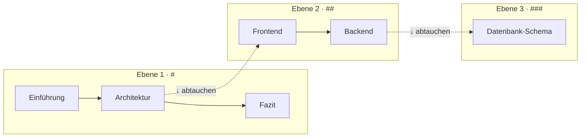
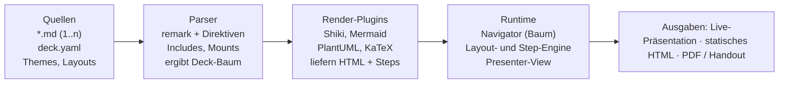
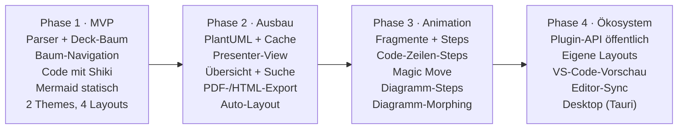

# Konzept: Markdown-Präsentations-App

Stand: 27.09.2026

## Vision & Ziele

Arbeitstitel **Strata**: Eine Präsentations-App, die aus 1..n Markdown-Dateien eine *navigierbare Wissenslandschaft* statt einer linearen Foliensequenz macht. Die Überschriften-Hierarchie ist die Struktur: Man präsentiert auf der Hauptebene und taucht bei Bedarf in Details ab – live, je nach Publikum und Fragen.

**Ziele**

- Markdown bleibt die einzige Quelle der Wahrheit: lesbar in jedem Editor, sinnvoll in Git versionierbar.
- Lineare Präsentation *und* Tiefen-Navigation mit derselben Quelle.
- Erstklassige technische Inhalte: Code, Mermaid, PlantUML – mit späterer Schritt-für-Schritt-Animation.
- Layout und Theming ohne HTML-Gebastel, über wenige deklarative Direktiven.

**Nicht-Ziele (vorerst)**

- Kein WYSIWYG-Editor; kein Ersatz für PowerPoint-Designarbeit.
- Keine Echtzeit-Kollaboration im MVP.

## Navigation über die Überschriften-Hierarchie

Jede Überschrift ist ein Knoten in einem Baum; jeder Knoten ist eine Folie (oder eine Folienfolge). Präsentiert wird entlang eines **Hauptpfads** auf Ebene 1; Unterknoten sind optionale Abstecher.

Nach rechts geht die Story weiter, nach unten geht es ins Detail:



→ nächster Knoten gleicher Ebene · ↓ ins Detail · Esc/↑ zurück zum Elternknoten · der Hauptpfad überspringt Ebene 2+.

**Bewegungsarten**

| Aktion | Taste (Vorschlag) | Wirkung |
| --- | --- | --- |
| Weiter / zurück | → / ← , Space | Nächster Geschwisterknoten; am Ende einer Ebene zurück zum Eltern-Nachfolger |
| Abtauchen | ↓ / Enter | In den ersten Kindknoten wechseln |
| Auftauchen | ↑ / Esc | Zum Elternknoten zurück, Position dort merken |
| Übersicht | O | Zoombare Baum-/Mindmap-Ansicht, Klick springt |
| Suche / Sprung | / oder Ctrl+K | Fuzzy-Suche über alle Überschriften |
| Linear-Modus | L | Tiefensuche durch den ganzen Baum (für Handout/Export) |

**UX-Details**

- *Tiefen-Indikator*: Breadcrumb oben (`Architektur › Backend`) und Punkt-Anzeige, wie viele Kinder ein Knoten hat.
- *Teaser-Kacheln*: Hat eine Folie Kinder, können diese automatisch als klickbare Kacheln unten erscheinen (`::: children`).
- *Übergänge*: Horizontal = Slide, vertikal = Zoom-In/Out – die Richtung wird räumlich spürbar.
- *Tiefen-Limit pro Vortrag*: `maxDepth: 2` blendet tiefere Ebenen aus (Kurzversion desselben Materials).
- *Deep-Links*: URL-Fragment pro Knoten (`#architektur/backend/db-schema`).

## Input-Modell: 1..n Markdown-Dateien

Ein Vortrag ist ein *Deck*, beschrieben durch ein optionales Manifest. Ohne Manifest gilt: alle `.md`-Dateien im Ordner, alphabetisch, jede Datei ist ein Teilbaum.

**Manifest `deck.yaml`**

```yaml
title: Systemarchitektur 2026
theme: ./themes/corporate.css
maxDepth: 3
mount:
  - file: intro.md                 # H1 der Datei wird Ebene-1-Knoten
  - file: architektur.md
  - file: backend/details.md
    under: "Architektur > Backend"  # hängt Datei unter bestehenden Knoten
    shiftHeadings: 2                # # wird zu ###
  - file: anhang.md
    hidden: true                    # nur per Sprung/Suche erreichbar
```

**Regeln für den Baum**

- `#` bis `######` bilden die Hierarchie; Text vor der ersten Überschrift ist der Inhalt des Datei-Knotens.
- `---` innerhalb eines Knotens teilt ihn in mehrere Folien (*Sub-Slides*), ohne neue Hierarchieebene.
- `<!-- notes -->` bzw. `::: notes` = Sprechernotizen.
- Includes: `!include ./snippets/auth-flow.md` bettet eine Datei an Ort und Stelle ein; `!include ./src/app.ts#L10-40` holt Code live aus dem Repo.
- Querverweise: `[siehe DB-Schema](#backend/db-schema)` wird zum internen Sprung.

**Direktiven-Syntax (Superset, bleibt valides Markdown)**

- Knoten-Attribute per Attribut-Syntax in geschweiften Klammern an der Überschrift:

```markdown
## Backend {layout=two-col transition=zoom id=backend}
```

- Blöcke per Container-Syntax (markdown-it-container / Pandoc-Fenced-Divs):

```markdown
::: columns
::: col
Linke Spalte
:::
::: col

:::
:::
```

- Fragmente (schrittweises Einblenden) per `{.fragment}` an Listenpunkten oder Blöcken.

## Content-Blöcke: Code, Diagramme, Animation

Alle Spezialblöcke laufen über ein **Plugin-Interface** für Fenced-Code-Blocks: Sprache/Info-String bestimmt den Renderer. Damit sind Mermaid, PlantUML & Co. gleichberechtigt und später erweiterbar (Vega-Lite, KaTeX, Excalidraw …).

**Code**

````markdown
```ts {lines="3-5|8|all" title="auth.ts"}
const token = await login(user)
```
````

- Syntax-Highlighting mit **Shiki** (VS-Code-Grammatiken und -Themes, identisch zum Editor).
- `lines="3-5|8|all"`: Schritte hervorheben – jeder `|`-Abschnitt ist ein Fragment.
- Später animiert: **Magic Move** zwischen zwei Code-Versionen (Token-Morphing, z. B. via `shiki-magic-move`), Tipp-Animation, Diff-Ansicht.
- Optional: ausführbare Snippets (Sandbox/WebContainer) als eigenes Plugin.

**Mermaid**

- Client-seitig gerendert, Theme-Variablen aus dem Deck-Theme gespeist.
- Animation Stufe 1: Knoten/Kanten per `%% step: 2` oder Klassen schrittweise einblenden (SVG-Elemente nach ID gruppieren).
- Animation Stufe 2: Zwischen zwei Diagrammversionen morphen (gleiche Knoten-IDs bleiben stehen, neue blenden ein).

**PlantUML**

- Rendering über konfigurierbaren Server (eigener Docker-Container oder lokales JAR im Build) → SVG, mit Cache per Inhalts-Hash.
- Für Offline/Datenschutz: Pre-Render im Build-Schritt; Inhalte nie ohne Opt-in an Fremdserver.
- Animation analog Mermaid auf SVG-Ebene; bei Sequenzdiagrammen ist ein Schritt eine Nachricht.

**Einheitliches Animationsmodell**

Jeder Renderer liefert eine Liste von *Steps* (DOM-/SVG-Selektoren + Zielzustand). Die Navigation behandelt Steps wie Fragmente: → spielt den nächsten Step, erst danach folgt die nächste Folie. Code, Diagramme und Listen teilen so dieselbe Tastenlogik und dieselben Sprechernotizen.

**Weitere Blöcke (Backlog)**

- Mathe (KaTeX), Callouts (`::: note/warning`), Bilder mit Zoom, Video/Embeds, Vega-Lite-Charts, Excalidraw.

## Layouting & Theming

Layouts sind benannte Vorlagen, Themes sind reine CSS-Variablen-Sets. Beides wird per Knoten-Attribut, Deck-Default oder automatisch gewählt.

**Layouts (Start-Set)**

| Layout | Einsatz | Slots |
| --- | --- | --- |
| `title` | Deck- und Kapitelstart | Titel, Untertitel, Hintergrund |
| `section` | Ebene-1-Knoten mit Kindern | Titel + Teaser-Kacheln der Kinder |
| `default` | Text, Listen | Titel, Inhalt |
| `two-col` / `three-col` | Vergleiche, Text + Diagramm | `::: col` je Spalte |
| `image-left` / `image-right` | Bild mit Erläuterung | Bild, Inhalt |
| `code-focus` | Großer Code, wenig Text | Code nimmt maximale Fläche |
| `diagram` | Vollflächiges Diagramm | Diagramm, optionale Legende |
| `quote` / `statement` | Kernaussage | Ein Satz, groß |

- **Auto-Layout**: Heuristik wählt ohne Attribut, z. B. nur Code-Block → `code-focus`, Bild + Text → `image-right`, Knoten mit Kindern und wenig Text → `section`.
- **Auto-Fit**: Text wird bis zu einer Mindestgröße skaliert; bei Überlauf Warnung im Editor statt stiller Schrift-Winzigkeit.
- **Eigene Layouts**: Vue/Svelte/HTML-Template mit benannten Slots in `./layouts/`.
- **Grid-Direktive** für Einzelfälle: `::: grid cols="2fr 1fr" gap=2`.

**Theming**

- Theme = CSS-Datei mit Design-Tokens: `--color-bg`, `--color-accent`, `--font-heading`, `--font-code`, `--radius`, `--space-*`.
- Dieselben Tokens speisen Shiki-Theme, Mermaid-`themeVariables` und PlantUML-`skinparam` – Diagramme passen automatisch zum Deck.
- Hell/Dunkel-Variante pro Theme, umschaltbar per Taste `T`.
- Pro Ebene stylebar: `[data-depth="3"]` erlaubt z. B. dezentere Detail-Folien.
- Mitgelieferte Themes: `minimal`, `dark-tech`, `corporate` (Logo, Fußzeile, Farben aus Konfig).

## Architektur & Tech-Stack

Empfehlung: Web-App (TypeScript) mit klarer Trennung von Parser, Plugins und Runtime. Der Kern ist ein framework-unabhängiger **Deck-Baum** als JSON – alles andere hängt daran.



**Bausteine**

| Baustein | Technologie (Vorschlag) | Aufgabe |
| --- | --- | --- |
| Parser | unified / remark, remark-directive, remark-frontmatter | Markdown → mdast → Deck-Baum (Knoten, Sub-Slides, Attribute) |
| Plugin-API | eigene TS-Schnittstelle `render(node, ctx) → {html, steps}` | Code, Mermaid, PlantUML, KaTeX, eigene |
| Runtime | Svelte oder Vue 3, Vite | Navigator-State-Machine, Layout-Engine, Übergänge |
| Animation | Web Animations API, FLIP; Motion One / GSAP optional | Fragmente, Magic Move, SVG-Morphing |
| Dev-Server | Vite + File-Watcher | Hot Reload beim Speichern, Folie bleibt stehen |
| Presenter-View | zweites Fenster via BroadcastChannel | Notizen, Timer, nächster Step, Baum-Minimap |
| Export | Playwright | PDF (linear oder bis `maxDepth`), statisches HTML |
| CLI | Node | `strata dev`, `strata build`, `strata export` |

**Deck-Baum (Kern-Datenmodell)**

```ts
interface DeckNode {
  id: string            // Slug-Pfad, z. B. "architektur/backend"
  title: string
  depth: number
  attrs: Record<string, string>  // layout, transition, hidden …
  slides: Slide[]        // Sub-Slides (durch ---)
  notes?: string
  children: DeckNode[]
  source: { file: string; line: number }  // für Editor-Sync
}
```

**Varianten zur Entscheidung**

- *Aufsetzen auf Slidev oder reveal.js*: reveal.js hat bereits 2D-Navigation (horizontal/vertikal), aber nur zwei Ebenen; Slidev bringt Shiki Magic Move und Mermaid mit, ist aber linear. Beide lassen sich als Prototyp nutzen, die beliebig tiefe Hierarchie müsste jedoch nachgebaut werden.
- *Eigenständig*: mehr Aufwand, dafür sauberes Baum-Modell ab Tag 1. Empfehlung: eigene Runtime, bestehende Bibliotheken (Shiki, Mermaid, Motion) als Bausteine.
- *Desktop-Variante* (Tauri) später, falls lokales PlantUML und Dateizugriff wichtig werden.

## Roadmap / MVP

Das MVP beweist die Kernidee: mehrere Markdown-Dateien ergeben einen Baum, durch den man live navigiert. Animation kommt bewusst erst in Phase 3, baut aber auf dem ab Phase 1 vorgesehenen Step-Modell auf.



**MVP ist fertig, wenn**

- [ ] ein realer Vortrag aus 3+ Dateien mit 3 Ebenen komplett in Strata gehalten werden kann,
- [ ] Hot Reload die aktuelle Position im Baum behält,
- [ ] Code und Mermaid im Deck-Theme erscheinen,
- [ ] Deep-Links und Baum-Übersicht funktionieren.

## Offene Fragen

- [ ] Eigene Runtime oder Prototyp auf reveal.js/Slidev? (Empfehlung oben: eigene Runtime)
- [ ] Svelte oder Vue 3 für die Runtime?
- [ ] Ist jede Überschrift eine Folie, oder nur Ebenen bis `maxDepth` – und tiefere werden als Abschnitte *innerhalb* einer Folie gerendert?
- [ ] PlantUML: eigener Server, lokales JAR oder Pre-Render im CI?
- [ ] Zielgruppe: nur eigene Vorträge oder auch Team/Firma (dann Corporate-Themes, Hosting, Freigabe)?
- [ ] Braucht es eine Web-Oberfläche zum Bearbeiten, oder reicht Editor + CLI + Hot Reload?
